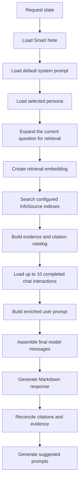

# InfoSource Assistant Context

## Purpose

This document summarizes the context assembled for the InfoSource assistant by `app/services/infoSourceSubmitGraphService.js`. It distinguishes context used to retrieve documents from context sent to the model that writes the final response.

## Context Assembly Flow

## Request State

The graph begins with:

- User identifier (`nuid`)
- Team name
- Assistant name
- Smart Note ID
- Current chat interaction, including the user's original question
- Selected sources
- InfoSource filter settings
- Optional progress and streaming callbacks

The Smart Note is then loaded. Its `selectedUserAssistant` can replace the assistant name supplied by the request, and its `persona` determines whether an additional persona prompt is loaded.

## Retrieval Context

### Query expansion

Query expansion is enabled unless `INFOSEARCH_QUERY_EXPANSION_MODE=off`.

The original question is sent to a model with instructions to:

- Preserve the user's intent
- Rewrite it as a retrieval-focused InfoSource query
- Add likely related terms and synonyms
- Add sales or presentation terminology that may locate relevant documents
- Return plain text only

The expanded query is normalized to one line and limited to 900 characters. If expansion fails or returns no text, the original question is used. This expanded query is used for search and embedding; it does not replace the original question in the final response prompt.

### Search indexes

The graph searches these configured indexes:

- `infosource_assets_2026-03-25`
- `infosource_pages2_2026-03-25`
- `kp-policy-2026-08-07`

The search combines the expanded text query with its vector embedding. The KP Policy index uses `contentVector` and the `default-semantic` configuration. The other indexes use their configured content vector field.

Content-type filters can limit the InfoSource asset and page indexes. The KP Policy index is always included and is not restricted by the InfoSource UI filters.

### Retrieved evidence

Retrieved results are ranked locally using query-term matches, Azure Search scores, and a recency boost. A limited set of results from each index becomes model context.

Each selected result contributes a compact evidence record containing available values such as:

- Index name
- Source or document title
- Section title
- Evidence snippet
- Unique document ID
- Keywords and category
- Market or region
- Owner
- Status
- Line of business, role, or function
- Last-updated or publication dates
- Source URL

The complete search document is retained on the citation object for the UI, but the final response model receives the compact evidence record rather than the entire raw document.

### Citation catalog

Selected results also form a numbered citation catalog. Each entry contains the source title and, when available:

- Region
- Owner
- Last-updated date
- URL

The catalog numbers are the only citation numbers the response model is allowed to use.

### Retrieval status

The enriched prompt can report one of these retrieval conditions:

- `live`: all expected retrieval completed normally
- `live-empty`: searches completed but returned no results
- `partial-live`: at least one index failed while another returned results
- `retrieval-unavailable`: all index searches failed

For any condition other than `live`, the model is warned that some indexes may be unavailable or may have returned no results.

## Conversation Context

The graph loads completed interactions from the current chat, sorts them by creation time, and keeps the latest 10 interactions.

Each interaction contributes two model messages:

1. A `user` message containing the prior prompt
2. An `assistant` message containing the prior response

This means the final request can include up to 20 historical messages. Incomplete interactions are excluded. Citations from prior interactions are not independently reattached; only the saved response text is included.

## Prompt Context

### Default system prompt

The default system prompt is loaded from the database using the resolved team and assistant names. This is the configurable assistant-level instruction layer.

### Persona prompt

If the Smart Note has a selected persona, the enabled persona prompt for the resolved team and assistant is loaded from the database and added as a second system message. If no persona is selected or the lookup fails, this layer is omitted.

### Built-in InfoSource instructions

The graph always adds a third system message that instructs the model to:

- Respond in Markdown
- Answer only within InfoSource scope
- Route application-support questions to the HPAIS support team
- Briefly refuse out-of-scope requests and direct users to appropriate KP staff
- Identify questions unrelated to KP and InfoSource
- Ground factual claims in the supplied context
- Cite every context-derived factual claim
- Use only citation numbers from the citation catalog
- Avoid fabricated citations
- Synthesize useful guidance when retrieved playbooks or frameworks support it
- Declare insufficient context only when evidence truly lacks actionable guidance
- Provide grounded do and do-not lists when requested
- Preserve core recommendations across follow-up questions unless new evidence requires a change
- Keep answers concise and practical

### Enriched user prompt

The final user message is assembled in this order:

1. Instruction to use only the supplied InfoSource context when possible
2. Instruction to state when context is insufficient
3. Citation requirements
4. Retrieval-status warning, when applicable
5. Numbered citation catalog
6. Compact retrieved evidence records
7. The user's original question

If no citations exist, the catalog says that none are available. If no evidence exists, the prompt explicitly says that no InfoSource context was retrieved.

## Final Model Message Order

The response-generation model receives messages in this exact order:

1. Default system prompt, when configured
2. Persona system prompt, when selected
3. Built-in InfoSource system instructions
4. Up to 20 messages representing the latest 10 completed interactions
5. Enriched user prompt containing retrieval evidence, citation catalog, status, and the current question

Response generation uses the configured chat model and token limit with temperature `0` for deterministic output.

## Post-Generation Processing

After generation, the graph:

- Detects responses treated as out of scope and removes citation artifacts from them
- Validates citation markers against retrieved citations
- Reorders and deduplicates displayed citations based on markers used in the response
- Adds supporting source markers when the response omits needed references
- Aligns citation content with claims in the response
- Produces up to three suggested follow-up prompts, unless the response is out of scope

## Important Context Boundaries

- Query expansion changes retrieval wording but not the original question shown to the response model.
- The final model sees snippets and metadata, not every field or the full text of every search result.
- Only completed interactions from the same chat are included as history.
- Prior response text can influence follow-up answers, but prior citation objects are not supplied as separate historical evidence.
- The KP Policy index is searched regardless of InfoSource content-type filters.
- The graph accepts selected sources in its state, but the current retrieval path is driven by the fixed index configuration and filter settings.
- The assistant-level system prompt and persona are database-configured, so their exact text varies by team, assistant, and Smart Note.

## Primary Implementation Files

- `app/services/infoSourceSubmitGraphService.js`
- `app/services/infoSourceSearchVectorDataService.js`
- `app/services/langgraphs/shared/nodes/addSystemPromptsNode.js`
- `app/services/langgraphs/shared/nodes/addPersonaPromptsNode.js`
- `app/api/[teamName]/[assistantName]/smartNote/[smartNoteId]/submitInfoSourceAssistant/route.js`