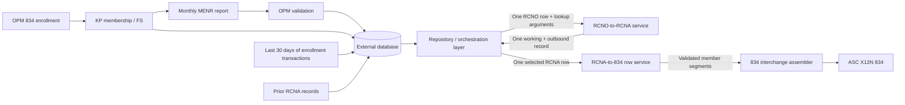

# PSHB RCNO to RCNA to X12 834 Detailed Business and Technical Design

## 1. Document purpose

This document defines the deterministic process for:

1. receiving one Office of Personnel Management (OPM) Postal Service Health Benefits (PSHB) RCNO database row as a service input argument;
2. reconciling that RCNO row against explicitly supplied KP membership, recent enrollment-transaction, and prior-RCNA database records;
3. returning one internal working RCNA record and one outbound RCNA record; and
4. transforming one supplied RCNA database row into validated ASC X12N 834 member segments that an orchestrator assembles into a complete 834 interchange.

The intended audiences are business analysts, reconciliation analysts, developers, testers, data engineers, and operations teams.

> **Important:** Business responses in `textDocs/AI834.csv` and `textDocs/rcno_to_rcna_answers.txt` resolve several RCNA and X12 decisions, including key envelope constants, recent-834 matching, date handling, address line 3, relationship values, and output-file partitioning. Some 834 intent mappings and identifiers remain incomplete or explicitly marked `TBD`. Section 19 distinguishes resolved, partially resolved, and outstanding questions. The implementation must fail validation rather than invent any remaining value.

---

## 2. Governing sources and conflict policy

### 2.1 Source precedence

Conflicts are resolved in the following order:

| Precedence | Source | Use |
|---:|---|---|
| 1 | `UserStory_PSHP_RCNA_draft_0724.txt` | Governing RCNA catalog, canonical rule IDs, priority, PSHB code, and description intent |
| 2 | `Epic_PSHB_RCNO.md` | Governing scope, cardinality, internal draft RCNA versus outbound RCNA distinction |
| 3 | `PSHB_RCNO_ASSIST_code_working_0715.txt` | Detailed rule predicates where the user story is not specific |
| 4 | `HEADERValues.csv` | X12 834 structure, usage, constants, examples, and element constraints |
| 5 | `pshbColumns.txt` and `supplementalResource.txt` | RCNA-to-834 field mapping and code lists |
| 6 | `Review 834 mapping.txt` | Meeting-derived business context and mapping intent |
| 7 | `textDocs/AI834.csv` and `textDocs/rcno_to_rcna_answers.txt` | Business responses to the outstanding RCNA and 834 design questions |
| 8 | `PSHB_RCNO_ASSIST_code.txt` and `PSHB_RCNO_ASSIST_20260410.txt` | Historical context only |

`myCopy.csv` and `SegmentDesc.csv` are byte-identical copies. They provide the base companion-guide descriptions but do not contain the populated value/sample column added in `HEADERValues.csv`.

### 2.2 Applied conflict resolutions

| Conflict | Governing decision |
|---|---|
| Rule A was variously defined as `M`, `M or Z`, priority `2`, code `ZM`, or priority `5`, code `MM` | Use user story: `column 4 = M`; priority `5`; code `MM`; description "Matches (no action required)" |
| Rule B either copied aging unchanged or incremented it | Use user story: copy prior priority/code/description and increment Aging Months by 1 |
| RCNA was described as 76, 77, or 78 columns | Use the approved 78-column contract for both internal working and newly generated outbound RCNA records; continue accepting legacy 76-column or current 78-column uploaded RCNA records |
| Working code contains malformed IDs such as `F109000`, `F110000`, `F132000`, `F143000` | Use canonical user-story IDs `F10000`, `F11000`, `F13000`, and `F14000` |
| Rule N12 code appears as `AE???`, `AE???KICKO`, or an unresolved manual code | Preserve it as unresolved; do not emit a fabricated production code |
| Older implementation applies only A, B, F1, and Default | Use all 51 scenarios in the July 24 user story |
| Source artifacts describe spreadsheet/file ingestion | The production service boundary is row-at-a-time and database-backed; file names remain source-system aliases only |
| Recent-834 rules alternate among member and subscriber SSNs and date sources | Match recent 834 evidence by subscriber SSN; use PSHBS coverage dates for F rules and MENR coverage dates for I and N rules |
| F1-F3 identify cancelled coverage by comparing coverage end to coverage start | Use the run's current business date to determine whether PSHBS coverage has ended |
| Address line 3 has no approved X12 destination | Omit address line 3 from the 834; do not append it to N302 |

### 2.3 Database-backed row-processing decision

The transformation services do not open files, query databases, or persist outputs. Each service invocation receives all data required to process one primary row as explicit arguments.

| Responsibility | Owner |
|---|---|
| Query RCNO, membership, recent enrollment, and prior RCNA data | External repository/orchestration layer |
| Establish a consistent database snapshot or business-effective query boundary | External repository/orchestration layer |
| Supply one RCNO row and its lookup candidates | RCNO processing orchestrator |
| Select one deterministic RCNA disposition | RCNO-to-RCNA transformation service |
| Persist working and outbound RCNA records | External repository/orchestration layer |
| Supply one selected RCNA row and approved 834 configuration | 834 processing orchestrator |
| Validate/map one RCNA row into an 834 member-loop representation | RCNA-to-834 transformation service |
| Group subscribers/dependents, order rows, calculate counts, assign control numbers, and write the interchange | 834 batch/interchange orchestrator |

This separation keeps the services deterministic and unit-testable. Database retries, pagination, transactions, connection management, and output delivery are infrastructure concerns outside the transformation classes.

---

## 3. Business background

KP receives OPM enrollment transactions and enrolls members in the KP membership system. KP reports membership to OPM through the monthly MENR process. OPM compares MENR to its records and returns an RCNO file that identifies whether:

- both organizations have the member and the data matches;
- OPM expects a member that KP does not have;
- KP has a member that OPM does not have; or
- both have the member but one or more values differ.

The automated reconciliation process evaluates the RCNO record against KP membership, 834 transactions from the preceding 30 days, and prior RCNA evidence stored for the current reconciliation cycle. It assigns a disposition that identifies ownership and the next action. The resulting RCNA closes the OPM reconciliation loop. The member attributes can also be rendered as an X12 834 for downstream enrollment processing.



### 3.1 Goals

- Produce exactly one RCNA result for every RCNO detail row.
- Apply one and only one disposition rule.
- Preserve the RCNO schema and source values.
- Make rule selection repeatable, explainable, and auditable.
- Reuse a prior disposition when the source reconciliation row has not changed.
- Generate structurally valid X12 834 transactions without exposing sensitive values in logs.

### 3.2 Out of scope

- Direct updates to OPM systems.
- Direct updates to KP membership systems.
- Inferring missing source columns or business values.
- Resolving N12's final PSHB code without business approval.
- Defining payer-specific 834 behavior not present in the supplied companion-guide extract.

---

## 4. Terms

| Term | Meaning |
|---|---|
| RCNO | OPM reconciliation database record identifying match or discrepancy results |
| RCNA | KP reconciliation database record containing the original RCNO fields and KP disposition |
| MENR | Monthly enrollment/membership report from KP to OPM |
| PSHBS | OPM/PSHB-side value in the RCNO |
| Membership / FS | KP membership reference data |
| Recent 834 | Enrollment transactions from the last 30 days used as reconciliation evidence |
| Working RCNA | Internal 78-field record used by analysts; includes Notes and Aging Months |
| Outbound RCNA | 78-field record prepared for delivery to OPM; columns 77 and 78 are Notes and Aging Months copied from the internal working RCNA |
| Primary row | The single RCNO or RCNA record supplied to one transformation invocation |
| Lookup candidates | Zero or more database records supplied with the primary row for deterministic evaluation |
| Rule family F | OPM/PSHBS member present but KP-side handling or coverage differs |
| Rule family I | KP/carrier enrollment exists but OPM-side handling or coverage differs |
| Rule family N | Demographic or enrollment attributes do not match |
| Reconciliation cycle | The explicit six-digit `YYYYMM` scope used to store and retrieve prior RCNA evidence for B200 |

---

## 5. Inputs and outputs

### 5.1 Service input and output records

Historical file names are retained as logical aliases so rule traceability is preserved. They do not imply that a transformation service reads a physical file.

| Logical alias | Service role | Required content |
|---|---|---|
| `file1_RCNO_CURRENT_ALL` | Primary argument | One current RCNO record with 73 fixed-position fields |
| `file3_MEMBERSHIP_KP_ALL` | Lookup argument | Zero or more candidate KP membership records |
| `file5_ENROLL_834_ALL` | Lookup argument | Zero or more enrollment records from the approved 30-day query window |
| `file6_RCNA_PRIOR_TEST` | Lookup argument | Zero or more prior working RCNA candidates |
| `file7_RCNA_ALL` | Returned value | One current working RCNA record |
| Outbound RCNA | Returned value | One 78-field outbound RCNA record |
| 834 member result | Returned value | Validated member-loop segments/structure for one RCNA row |
| X12 834 | Orchestrator output | One interchange assembled from multiple member results |

The repository layer must provide database records in the canonical positional contract defined by this document, or map named database columns into that contract before calling a transformation service.

### 5.2 Uploaded RCNA prior evidence

The manual **Import RCNA into prior history** action requires the administrator to select a reconciliation cycle in strict `YYYYMM` format. The server validates that the month is `01` through `12`; it does not infer the cycle from the file name or upload date.

After the RCNA is parsed and validated, every uploaded RCNA row is persisted as prior evidence for the selected cycle. Uploads may contain either 76 columns for backward compatibility or the current 78-column outbound format. A legacy 76-column RCNA is restored to the 78-column working shape with blank Notes and Aging Months `0`. A 78-column RCNA retains its Notes and a valid nonnegative integer Aging Months value; a blank Aging Months value becomes `0`. Invalid decision columns or Aging Months reject the import without writing prior evidence. This normalization does not otherwise change uploaded-RCNA processing.

Prior evidence is upserted by protected columns 1-73 match key plus reconciliation cycle. A later generated or uploaded RCNA for the same key and cycle replaces the earlier decision. Evidence in another cycle remains separate and cannot satisfy B200.

RCNA import and 834 generation are separate operations. A successful import creates an `RCNA_IMPORT` run in `AWAITING_RCNA_REVIEW` and does not evaluate 834 selection, mapping approval, intent mappings, or carrier-action eligibility. Every valid uploaded row, including rows that will not produce an 834 member loop, is imported into cycle-scoped prior history. An administrator may later invoke **Generate 834** for that run. The later operation reads the stored uploaded RCNA artifact, filters only the carrier-action rows eligible under Section 12.1, and applies all remaining Section 12 gates and mappings to those selected rows. Failure to generate the optional 834 returns the run to `AWAITING_RCNA_REVIEW` and does not roll back prior evidence already imported successfully.

### 5.3 Cardinality

- Every successful RCNO service invocation returns exactly one working RCNA record.
- Every successful RCNO service invocation returns exactly one 78-field outbound RCNA record. Columns 77 and 78 contain the same Notes and Aging Months values as the working RCNA record.
- A rejected invocation returns no success-shaped RCNA record and surfaces an explicit error.
- The 834 row service is invoked only for an RCNA row selected by the approved 834-selection policy.
- Every successful 834 row-service invocation returns exactly one INS-loop representation.
- A subscriber group contains one subscriber and zero or more dependents.
- Aggregate input/output counts are an orchestration concern and must be reconciled using database work-item identifiers.

### 5.4 Transformation service contracts

The examples below define logical JavaScript contracts. Exact database entity names may differ, but the transformation boundary must remain row-at-a-time.

#### RCNO to RCNA

```javascript
rcnoToRcnaService.transformRow({
  rcnoRecord,                 // exactly one canonical 73-field record
  membershipCandidates,      // zero or more canonical membership records
  recentEnrollmentCandidates,// zero or more canonical recent-enrollment records
  priorRcnaCandidates,       // zero or more canonical prior RCNA records
  context: {
    correlationId,
    workItemId,
    businessDate,
    ruleCatalogVersion,
    configurationVersion,
  },
});

// Returns:
{
  workingRcnaRecord,          // exactly 78 fields
  outboundRcnaRecord,         // exactly 78 fields; Notes and Aging Months match workingRcnaRecord
  audit,                      // non-sensitive rule evaluation metadata
}
```

#### RCNA to 834 member loop

```javascript
rcnaTo834Service.transformRow({
  workingRcnaRecord,          // exactly one canonical 78-field record
  transactionIntent,         // approved code-to-834 intent
  context: {
    correlationId,
    workItemId,
    businessDate,
    configurationVersion,
  },
});

// Returns:
{
  subscriberKey,
  memberSortKey,
  isSubscriber,
  segments,                   // one validated INS loop and its child segments
  audit,
}
```

Neither method accepts a database client, repository, file path, stream, workbook, or output destination. Neither method performs side effects.

---

## 6. Input contract and normalization

### 6.1 Row contract rules

1. Accept exactly one primary row per service invocation.
2. Process only RCNO rows whose `Record_Type` (RCNO column 1) is `01`, which may appear as `1` or `01`. The orchestration layer ignores every other row, including `2`/`02` (the other row type), blank, and any other value, before the field-count check in rule 8 and before any lookup, transformation, prior-evidence save, or count. An ignored row is not an error and may have any number of columns. After the optional ignored leading column is removed, `Record_Type` is compared after trimming whitespace and removing leading zeroes, so `1`, `01`, and ` 01 ` all match, while `2`, `02`, `03`, and blank do not. If no `01` row remains, the run fails with the message `RCNO file does not contain any Record_Type 01 rows`. A row that is not a `Record_Type 01` row never reaches a transformation service invocation, so rule 1 and the field-count rule apply only to `01` rows.
3. Accept lookup candidates as explicit arguments; the service must not query for additional data.
4. Preserve every declared field, including empty values.
5. Do not infer, rename, reorder, merge, or drop fields.
6. Receive values as strings to preserve leading zeroes.
7. Represent a database `NULL` as an empty string only in the repository mapping layer; the transformation receives canonical strings.
8. Reject the invocation before rule processing if the primary row or a supplied lookup record violates its required field count.
9. Continue deterministic evaluation when no lookup candidate matches.
10. Treat identical duplicate lookup records as one logical candidate.
11. Reject conflicting duplicate candidates when selecting one arbitrarily could change the rule result.
12. Do not mutate any input argument.

Row numbers in parse errors count non-blank input lines. All other row numbers (error report, run items, admin run detail, and blocked-row log) count only the retained `Record_Type 01` rows, in file order, so they are not the physical line numbers of the source file when `02` or blank rows precede them.

### 6.2 Database snapshot and query requirements

The repository/orchestration layer must:

1. obtain the RCNO row and lookup candidates from a consistent database snapshot or documented business-effective boundary;
2. capture the current calendar date once at run start as `businessDate` and apply the 30-day enrollment lookback and all current-date predicates using that value, not a per-row server timestamp;
3. provide stable source identifiers for the primary row and every lookup candidate;
4. use deterministic ordering and pagination when scheduling rows;
5. prevent or detect concurrent duplicate processing through an idempotency key; and
6. pass the business date, rule-catalog version, and configuration version explicitly.

### 6.3 Comparison normalization

Create comparison-only values without modifying the original output values:

1. remove control characters;
2. trim leading and trailing whitespace;
3. normalize non-breaking spaces to regular spaces;
4. uppercase text;
5. compare dates as valid `YYYYMMDD` dates; and
6. preserve SSNs and identifiers as strings.

An invalid date or malformed required identifier is a row-level validation error. It must not be silently converted.

### 6.4 Sensitive data

RCNO, RCNA, membership, and 834 records may contain names, dates of birth, addresses, member identifiers, and SSNs. Logs must contain only correlation IDs, database source identifiers, rule IDs, counts, and masked identifiers. Raw records, database connection details, query parameters containing PII, and unmasked SSNs must never be logged.

---

## 7. RCNO 73-column data dictionary

The RCNO consists of record type followed by 24 three-column comparison groups: PSHBS value, MENR value, and comparison result.

| Col. | Field | Role |
|---:|---|---|
| 1 | `Record_Type` | `01` (also written `1`) identifies a data row and is the only value processed. Rows with any other value, such as `2` or `02`, are ignored in full before validation, lookup, transformation, and counting (Section 6.1, rule 2). The retained column is copied unchanged into RCNO/RCNA column 1 |
| 2 / 3 / 4 | `PSHBS_Subscriber_ID` / `MENR_Subscriber_ID` / `RCNO_Subscriber_ID_Result` | Subscriber identity and overall result |
| 5 / 6 / 7 | `PSHBS_Member_ID` / `MENR_Member_ID` / `RCNO_Member_ID_Result` | Member ID; `MENR_Member_ID` is a required 20-character field, left justified with appropriate leading zeroes to match other files |
| 8 / 9 / 10 | `PSHBS_Annuitant_Number` / `MENR_Annuitant_Number` / `RCNO_Annuitant_Number_Result` | Annuitant number |
| 11 / 12 / 13 | `PSHBS_Last_Name` / `MENR_Last_Name` / `RCNA_Last_Name_Result` | Last name |
| 14 / 15 / 16 | `PSHBS_First_Name` / `MENR_First_Name` / `RCNO_First_Name_Result` | First name |
| 17 / 18 / 19 | `PSHBS_Birth_Date` / `MENR_Birth_Date` / `RCNO_Birth_Date_Result` | Birth date |
| 20 / 21 / 22 | `PSHBS_Member_SSN` / `MENR_Member_SSN` / `RCNO_Member_SSN_Result` | Member SSN |
| 23 / 24 / 25 | `PSHBS_Subscriber_SSN` / `MENR_Subscriber_SSN` / `RCNO_Subscriber_SSN_Result` | Subscriber SSN |
| 26 / 27 / 28 | `PSHBS_Plan_Code` / `MENR_Plan_Code` / `RCNO_Plan_Code_Result` | Plan code |
| 29 / 30 / 31 | `PSHBS_Coverage_Start_Date` / `MENR_Coverage_Start_Date` / `RCNA_Coverage_Start_Result` | Coverage start |
| 32 / 33 / 34 | `PSHBS_Coverage_End_Date` / `MENR_Coverage_End_Date` / `RCNO_Coverage_End_Result` | Coverage end |
| 35 / 36 / 37 | `PSHBS_Address_Line1` / `MENR_Address_Line1` / `RCNO_Address_Line1_Result` | Address line 1 |
| 38 / 39 / 40 | `PSHBS_Address_Line2` / `MENR_Address_Line2` / `RCNO_Address_Line2_Result` | Address line 2 |
| 41 / 42 / 43 | `PSHBS_Address_Line3` / `MENR_Address_Line3` / `RCNO_Address_Line3_Result` | Address line 3 |
| 44 / 45 / 46 | `PSHBS_City` / `MENR_City` / `RCNO_City_Result` | City |
| 47 / 48 / 49 | `PSHBS_State` / `MENR_State` / `RCNO_State_Result` | State |
| 50 / 51 / 52 | `PSHBS_ZIP` / `MENR_ZIP` / `RCNO_ZIP_Result` | Postal code |
| 53 / 54 / 55 | `PSHBS_Country` / `MENR_Country` / `RCNO_Country_Result` | Country |
| 56 / 57 / 58 | `PSHBS_Phone` / `MENR_Phone` / `RCNO_Phone_Result` | Phone |
| 59 / 60 / 61 | `PSHBS_Email` / `MENR_Email` / `RCNO_Email_Result` | Email |
| 62 / 63 / 64 | `PSHBS_Payroll_Office_Number` / `MENR_Payroll_Office_Number` / `RCNO_Payroll_Office_Result` | Payroll office |
| 65 / 66 / 67 | `PSHBS_Relationship_Code` / `MENR_Relationship_Code` / `RCNO_Relationship_Result` | Relationship |
| 68 / 69 / 70 | `PSHBS_Extended_Cov_End_Date` / `MENR_Extended_Cov_End_Date` / `RCNO_Extended_Cov_End_Result` | Extended coverage end |
| 71 / 72 / 73 | `PSHBS_Gender_Code` / `MENR_Gender_Code` / `RCNO_Gender_Code_Result` | Gender |

Result values used by the rules include:

| Value | Interpretation |
|---|---|
| `M` | Match |
| `F` | PSHBS/OPM-side enrollment discrepancy family |
| `I` | KP/carrier-side enrollment discrepancy family |
| `N` | Non-match/demographic discrepancy family |
| `Z` | Appears in older source material but is not approved by the governing user story |

---

## 8. Lookup schemas and matching

### 8.1 Membership fields

#### Alignment to MDW DB
- Coverage joins to membership by `PRSN_IK`, `RGN_CD`, and `MBRSHP_LNE_NB = LNE_NB`; these columns align with the leading columns of `PKMBRSHP_CVRG_OPTN`.
- LNE_NB represents the different memberships
- When SBSCRB_PRSN_IK = PRSN_IK then the row in MBRSH_CURRENT is the subscriber
- SBSCRB_TYP_CD holds the sub type

| Col. | Field | Notes | MDW_DB |
|---:|---|---|---|
| 1 | `kp_mrn` | Membership key | PRSN_CRNT.MRN_NB
| 2 | `Coverage_Start_Date` | `YYYYMMDD` | MBRSHP_CRNT.MBRSHP_EFF_STRT_DT
| 3 | `Coverage_End_Date` | Nullable `YYYYMMDD` | MBRSHP_CRNT.MBRSHP_EFF_END_DT
| 4 | `first_name` | Member first name | PRSN_CRNT.FRST_NM
| 5 | `last_name` | Member last name | PRSN_CRNT.LST_NM
| 6 | `member_ssn` | Nine-character string | PRSN_CRNT.SSN_NB
| 7 | `member_gender` | `M`, `F`, or `U` | PRSN_CRNT.GNDR_CD
| 8 | `Relationship_Code` | Membership relationship | MBRSHP_CRNT.REL_TO_SBSCRB_CD
| 9 | `plan_code` | Three-character plan | MBRSHP_CVRG_OPTN_CRNT.SRC_SYS_KEY_3_TX (provisional physical mapping)
| 10 | `Annuitant_Number` | Annuitant value |
| 11 | `Payroll_Office_Number` | Payroll office |
| 12 | `Member_Deceased` | Expected `Y`/`N` | PRSN_DEATH_CRNT.DEATH_DT is set
| 13 | `Subscriber_Deceased` | Expected `Y`/`N` | PRSN_DEATH_CRNT.DEATH_DT is set
| 14 | `Member_Age` | Numeric age | PRSN_CURRENT.BRTH_DT (calc age)
| 15 | `Not_Disabled` | Expected `Y`/`N` |
| 16 | `Subscriber_SSN` | Subscriber grouping key |  PRSN_CRNT.SSN_NB
| 17 | `Medicare_Member` | Used by name/birth-date exception logic in the working rules |
| 18 | `Member_Birth_Date` | `YYYYMMDD` | PRSN_CURRENT.BRTH_DT
| 19 | `Member_Deceased_Date` | Nullable `YYYYMMDD` | PRSN_DEATH_CRNT.DEATH_DT
| 20-25 | Membership address fields | Address lines 1-3, city, state, ZIP/country; source numbering is inconsistent and must be confirmed | MBRSHP_ADDR_CRNT

#### 8.1.1 MDW membership query

The following Oracle query produces the 19-column positional contract consumed by `RcnoToRcnaService`. It is based on the `MDW2_V` mappings supplied in Section 8.1. Column 9 provisionally maps the stable three-character coverage source key observed per membership line; columns 10-11, 15, and 17 remain `NULL` because the source design does not identify authoritative MDW columns for those values.

At runtime this statement is stored in the versioned MongoDB `RcnoaQueryConfiguration.mdwQuery` field and is editable from the RCNOA admin page. Validation requires `:businessDate`, `:ssnsJson`, and `:mrnsJson`. The SSN bind is mandatory for F-family candidate retrieval because F rows locate membership by member first name, member last name, and subscriber SSN and are not expected to contain a member MRN. The MRN bind is mandatory because every I- and N-family rule locates membership by normalized RCNO `MENR_Member_ID` to MDW `kp_mrn`. The statement must remain read-only, return the same 19-column positional contract, and order rows by `coverage_end_date DESC NULLS LAST`. The SQL below is sourced from the repository-level `baseConfigMDWQuery.sql` and is the seed value used when that configuration is first created.

```sql
WITH runtime AS (
  SELECT TO_DATE(:businessDate, 'YYYYMMDD') AS business_date
  FROM dual
),
lookup_ssns AS (
  SELECT lookup_key
  FROM JSON_TABLE(
    :ssnsJson,
    '$[*]' COLUMNS (lookup_key VARCHAR2(20) PATH '$')
  )
),
lookup_mrns AS (
  SELECT lookup_json.lookup_key
  FROM JSON_TABLE(
    :mrnsJson,
    '$[*]' COLUMNS (
      lookup_key VARCHAR2(20) PATH '$'
    )
  ) lookup_json
),
matched_people AS (
  SELECT DISTINCT member_person.PRSN_IK
  FROM lookup_mrns lookup
  JOIN MDW2_V.PRSN_CRNT member_person
    ON member_person.MRN_NB = LTRIM(SUBSTR(lookup.lookup_key, 3, 12), '0')
   AND member_person.MRN_PFX_NB = TO_CHAR(TO_NUMBER(SUBSTR(lookup.lookup_key, 1, 2)))
),
ranked_memberships AS (
  SELECT matched_people.PRSN_IK AS matched_prsn_ik,
         membership.PRSN_IK,
         membership.RGN_CD,
         membership.LNE_NB,
         MAX(membership.LNE_NB) OVER (
           PARTITION BY membership.PRSN_IK
         ) AS max_lne_nb
  FROM matched_people
  CROSS JOIN runtime
  JOIN MDW2_V.MBRSHP_CRNT membership
    ON membership.PRSN_IK = matched_people.PRSN_IK
),
candidate_people AS (
  SELECT person.PRSN_IK,
         person.RGN_CD
  FROM lookup_ssns lookup
  JOIN MDW2_V.PRSN_CRNT person
    ON lookup.lookup_key = person.SSN_NB
  WHERE person.RGN_CD IN ('SC', 'NC')
  UNION
  SELECT matched_prsn_ik AS PRSN_IK,
         RGN_CD
  FROM ranked_memberships
  WHERE LNE_NB = max_lne_nb
    AND RGN_CD IN ('SC', 'NC')
),
candidate_membership AS (
  SELECT membership.*
  FROM candidate_people candidate
  JOIN runtime ON 1 = 1
  JOIN MDW2_V.MBRSHP_CRNT membership
    ON candidate.PRSN_IK = membership.PRSN_IK
)
SELECT DISTINCT
  member_person.MRN_PFX_NB || LPAD(TO_CHAR(member_person.MRN_NB), 10, '0')    -- 1
    AS kp_mrn,
  TO_CHAR(membership.MBRSHP_EFF_STRT_DT, 'YYYYMMDD')                         -- 2
    AS coverage_start_date,
  TO_CHAR(membership.MBRSHP_EFF_END_DT, 'YYYYMMDD')                          -- 3
    AS coverage_end_date,
  member_person.FRST_NM AS first_name,                                        -- 4
  member_person.LST_NM AS last_name,                                          -- 5
  member_person.SSN_NB AS member_ssn,                                         -- 6
  NVL(member_person.GNDR_CD, 'U') AS member_gender,                           -- 7
  membership.REL_TO_SBSCRB_CD AS relationship_code,                          -- 8
  coverage.SRC_SYS_KEY_3_TX AS plan_code,                                     -- 9
  CAST(NULL AS VARCHAR2(50)) AS annuitant_number,                             -- 10
  CAST(NULL AS VARCHAR2(50)) AS payroll_office_number,                        -- 11
  CASE WHEN member_death.DEATH_DT IS NULL THEN 'N' ELSE 'Y' END               -- 12
    AS member_deceased,
  CASE WHEN subscriber_death.DEATH_DT IS NULL THEN 'N' ELSE 'Y' END           -- 13
    AS subscriber_deceased,
  TRUNC(MONTHS_BETWEEN(runtime.business_date, member_person.BRTH_DT) / 12)     -- 14
    AS member_age,
  CAST(NULL AS VARCHAR2(1)) AS not_disabled,                                  -- 15
  subscriber_person.SSN_NB AS subscriber_ssn,                                 -- 16
  CAST(NULL AS VARCHAR2(1)) AS exception_flag,                                -- 17
  TO_CHAR(member_person.BRTH_DT, 'YYYYMMDD') AS member_birth_date,            -- 18
  TO_CHAR(member_death.DEATH_DT, 'YYYYMMDD') AS member_deceased_date          -- 19
FROM candidate_membership membership
JOIN MDW2_V.PRSN_CRNT member_person
  ON member_person.PRSN_IK = membership.PRSN_IK
JOIN MDW2_V.PRSN_CRNT subscriber_person
  ON subscriber_person.PRSN_IK = membership.SBSCRB_PRSN_IK
JOIN MDW2_V.MBRSHP_CVRG_OPTN_CRNT coverage
  ON coverage.PRSN_IK = membership.PRSN_IK
 AND coverage.RGN_CD = membership.RGN_CD
 AND coverage.MBRSHP_LNE_NB = membership.LNE_NB
OUTER APPLY (
  SELECT MAX(death.DEATH_DT) AS DEATH_DT
  FROM MDW2_V.PRSN_DEATH_CRNT death
  WHERE death.PRSN_IK = member_person.PRSN_IK
) member_death
OUTER APPLY (
  SELECT MAX(death.DEATH_DT) AS DEATH_DT
  FROM MDW2_V.PRSN_DEATH_CRNT death
  WHERE death.PRSN_IK = subscriber_person.PRSN_IK
) subscriber_death
CROSS JOIN runtime
ORDER BY coverage_end_date DESC NULLS LAST, kp_mrn;
```

MDW deployment checks:

- Keep `baseConfigMDWQuery.sql` and the default `RcnoaQueryConfiguration.mdwQuery` seed synchronized. The base query splits the first two MENR ID characters into `MRN_PFX_NB`, strips insignificant zeroes from the remaining MRN number for lookup, limits candidates to regions `SC` and `NC`, selects the highest membership line number for MRN candidates, and reconstructs `kp_mrn` as prefix plus a ten-character padded number.
- The coverage-option join must retain all three predicates: `coverage.PRSN_IK = membership.PRSN_IK`, `coverage.RGN_CD = membership.RGN_CD`, and `coverage.MBRSHP_LNE_NB = membership.LNE_NB`. Joining only by line number crosses people and regions, multiplies rows, and prevents use of the leading `PKMBRSHP_CVRG_OPTN` columns.
- The deployed `mdwQuery` must use both `:mrnsJson` and `:ssnsJson`, preserve the 19-column output contract, and order by `coverage_end_date DESC NULLS LAST`. Runtime MRN normalization makes the reconstructed `kp_mrn` equivalent to the original MENR member ID despite insignificant leading zeroes.
- Confirm against authoritative MDW metadata that `MBRSHP_CVRG_OPTN_CRNT.SRC_SYS_KEY_3_TX` is the MENR three-character enrollment code. Sample data shows one stable value per membership line and exact roll-up of option dates to `MBRSHP_EFF_STRT_DT`/`MBRSHP_EFF_END_DT`. Supply authoritative mappings for annuitant number, payroll office number, disability, and the implementation's exception flag before enabling rule paths that require columns 10-11, 15, or 17.
- Add any required current-row or effective-date predicates defined by the `MDW2_V` view contract. Do not infer those predicates solely from the `_CRNT` suffix.
- Verify whether `PRSN_DEATH_CRNT` is already unique by `PRSN_IK`. The aggregate prevents duplicate lookup rows while preserving the latest death date.

### 8.2 Recent 834 lookup

The governing working source describes:

| Col. | Field | Notes |
|---:|---|---|
| 1 | `Subscriber_SSN` | String key used for all recent-834 reconciliation |
| 2 | `Coverage_Start_Date` | `YYYYMMDD` |
| 3 | `Coverage_End_Date` | `YYYYMMDD` |
| 4 | `834_Processed` | `Y` or `N` |

Older material swaps columns 2 and 3 and omits `834_Processed`. The four-column July 15 layout governs.

#### 8.2.1 EPDS prior-30-day 834 query

The following Oracle query uses the EPDS relationships and columns defined in `EPDS.sql`. It returns the exact four-column positional contract consumed by `RcnoToRcnaService`. The half-open interval includes interchanges from midnight 30 days before `:businessDate` and excludes interchanges at or after midnight on `:businessDate`, yielding exactly the prior 30 calendar days.

At runtime this statement is stored in the versioned MongoDB `RcnoaQueryConfiguration.epdsQuery` field and is editable from the RCNOA admin page. The SQL below is the seed value used when that configuration is first created.

```sql
WITH runtime AS (
  SELECT TO_TIMESTAMP(:businessDate, 'YYYYMMDD') AS business_timestamp
  FROM dual
)
SELECT DISTINCT
  demographics.SSN AS subscriber_ssn,                                         -- 1
  TO_CHAR(coverage_member.EFFECTIVE_START_DATE, 'YYYYMMDD')                   -- 2
    AS coverage_start_date,
  TO_CHAR(coverage_member.EFFECTIVE_END_DATE, 'YYYYMMDD')                     -- 3
    AS coverage_end_date,
  CASE                                                                         -- 4
    WHEN UPPER(TRIM(batch.STATUS_CODE)) = 'SUCCESS' THEN 'Y'
    ELSE 'N'
  END AS processed
FROM RAWDATA_OWNER.FILE_INFO file_info
JOIN RAWDATA_OWNER.BATCH_RUN batch
  ON batch.BATCH_IK = file_info.BATCH_IK
   AND batch.SOURCE_FILE_NAME = file_info.SOURCE_FILE_NAME
JOIN RAWDATA_OWNER.HEALTH_COVERAGE coverage
  ON coverage.REGION_CODE = file_info.REGION_CODE
   AND coverage.INTERCHANGE_CONTROL_NUMBER = file_info.INTERCHANGE_CONTROL_NUMBER
   AND coverage.SOURCE_FILE_NAME = file_info.SOURCE_FILE_NAME
JOIN RAWDATA_OWNER.HEALTH_COVERAGE_MEMBER coverage_member
  ON coverage_member.REGION_CODE = coverage.REGION_CODE
   AND coverage_member.INTERCHANGE_CONTROL_NUMBER = coverage.INTERCHANGE_CONTROL_NUMBER
   AND coverage_member.TRANSACTIONSET_CONTROL_NUMBER = coverage.TRANSACTIONSET_CONTROL_NUMBER
   AND coverage_member.SOURCE_FILE_NAME = coverage.SOURCE_FILE_NAME
JOIN RAWDATA_OWNER.MEMBER_DEMOGRAPHICS demographics
  ON demographics.REGION_CODE = coverage_member.REGION_CODE
   AND demographics.INTERCHANGE_CONTROL_NUMBER = coverage_member.INTERCHANGE_CONTROL_NUMBER
   AND demographics.TRANSACTIONSET_CONTROL_NUMBER = coverage_member.TRANSACTIONSET_CONTROL_NUMBER
   AND demographics.HEALTH_COVERAGE_MEMBER_IK = coverage_member.HEALTH_COVERAGE_MEMBER_IK
   AND demographics.SOURCE_FILE_NAME = coverage_member.SOURCE_FILE_NAME
CROSS JOIN runtime
WHERE UPPER(TRIM(file_info.FILE_TYPE)) = '834'
  AND file_info.INTERCHANGE_TIMESTAMP >= runtime.business_timestamp - INTERVAL '30' DAY
  AND file_info.INTERCHANGE_TIMESTAMP < runtime.business_timestamp
  AND demographics.SSN IS NOT NULL
  AND coverage_member.EFFECTIVE_START_DATE IS NOT NULL;
```

EPDS deployment checks:

- Confirm the actual 834 value stored in `FILE_INFO.FILE_TYPE`. Replace the query literal only if the EPDS owner confirms a different code.
- Confirm the successful terminal value or values for `BATCH_RUN.STATUS_CODE`. The DDL defines the column but no status domain; `SUCCESS` is therefore a deployment assumption, not a DDL-proven value. Failed and in-progress batches must continue to map to `N`.
- Confirm whether `EFFECTIVE_START_DATE` and `EFFECTIVE_END_DATE` on `HEALTH_COVERAGE_MEMBER` are the business-approved member coverage dates. Header-level `HEALTH_COVERAGE.COVERAGE_START_DATE` and `COVERAGE_END_DATE` are intentionally not used because reconciliation matches an individual member.
- Confirm the `MEMBER_DEMOGRAPHICS.PERSON_TYPE_CODE` value or equivalent relationship that identifies the subscriber and add the corresponding predicate/join before production deployment. The approved reconciliation key is subscriber SSN; the query must not return a dependent/member SSN in column 1.
- If the approved lookback includes the business date, change only the upper bound to `< runtime.business_timestamp + INTERVAL '1' DAY`; retain a half-open interval to avoid time-of-day boundary defects.

### 8.3 Match strategies

| Match | Predicate |
|---|---|
| Prior RCNA exact match | Within the current `YYYYMM` reconciliation cycle, current RCNO columns 1-73 equal stored prior RCNA columns 1-73 after comparison normalization. Evidence may come from a generated RCNA or a successfully processed manual RCNA upload. |
| F-family membership | Normalized PSHBS member first name + normalized PSHBS member last name + normalized PSHBS subscriber SSN = MDW membership first name + last name + subscriber SSN. Comparison is case-insensitive, ignores surrounding whitespace, and does not require `MENR_Member_ID`; F-family RCNO rows are not expected to contain a member MRN. |
| I/N-family membership by MRN | Membership `kp_mrn` = RCNO `MENR_Member_ID` (column 6). For digit-only values, compare after removing insignificant leading zeroes from both values; preserve the original values in all records and outputs. If multiple MDW rows match the MRN, sort populated `Coverage_End_Date` values descending, place blank end dates last, and evaluate the first row. Member SSN, subscriber SSN, and member name do not establish I/N-family membership. |
| Recent 834 for F rules | Subscriber SSN + PSHBS coverage start + PSHBS coverage end; processing status is an additional predicate where required |
| Recent 834 for I and N rules | Subscriber SSN + MENR coverage start + MENR coverage end; processing status is an additional predicate where required |

When duplicate lookup rows satisfy a rule predicate:

- multiple I- or N-family membership rows matched by normalized MRN follow the deterministic `Coverage_End_Date` ordering above and are not an ambiguity merely because more than one MRN row exists;
- identical duplicates may be collapsed for evaluation;
- conflicting duplicates for lookup strategies without an approved deterministic selector are an ambiguity error for the RCNO row;
- the row must be routed for manual resolution rather than selecting a lookup arbitrarily.

### 8.4 Source-specific expected data contracts (EPDS and MDW)

The design already defines lookup schemas in Sections 8.1 and 8.2, but those sections do not explicitly label the expected upstream system of record. This subsection makes that expectation explicit for implementation planning.

#### 8.4.1 EPDS expected data (enrollment transaction evidence)

For RCNO-to-RCNA reconciliation, EPDS is expected to provide the recent enrollment transaction evidence that populates `recentEnrollmentCandidates` (logical alias `file5_ENROLL_834_ALL`).

| EPDS field (logical) | Canonical lookup field | Required | Notes |
|---|---|---|---|
| Subscriber SSN | `Subscriber_SSN` | Yes | Matching key used by F/I/N rules |
| Coverage start date | `Coverage_Start_Date` | Yes | `YYYYMMDD` |
| Coverage end date | `Coverage_End_Date` | Yes | `YYYYMMDD` |
| Processed indicator | `834_Processed` | Yes | `Y` or `N`; required for processed vs pending rule paths |
| Source transaction identifier | Invocation audit metadata | Yes | Stable DB identifier for audit and traceability |
| Transaction effective/business date | Repository/orchestration metadata | Yes | Must align with approved 30-day lookback boundary |

Implementation notes:

- This contract is evidence-oriented and is not the full outbound 834 payload model.
- If EPDS cannot supply `834_Processed`, the invocation is contract-invalid for rules that require processed-state branching.
- Recent-834 reconciliation uses subscriber SSN as its identity key. Member SSN remains available for member payload mapping but is not the recent-834 match key.

#### 8.4.2 MDW expected data (membership reference)

For RCNO-to-RCNA reconciliation, MDW is expected to provide membership reference rows that populate `membershipCandidates` (logical alias `file3_MEMBERSHIP_KP_ALL`).

| MDW field (logical) | Canonical lookup field | Required | Notes |
|---|---|---|---|
| Member record number | `kp_mrn` | Yes | Primary membership match key |
| Coverage start date | `Coverage_Start_Date` | Yes | `YYYYMMDD` |
| Coverage end date | `Coverage_End_Date` | No | Nullable `YYYYMMDD` |
| First name | `first_name` | Yes | Used in identity and discrepancy rules |
| Last name | `last_name` | Yes | Used in identity and discrepancy rules |
| Member SSN | `member_ssn` | Yes | Nine-character string |
| Subscriber SSN | `Subscriber_SSN` | Yes | Grouping and matching key |
| Relationship code | `Relationship_Code` | Yes | Required by relationship-based rules |
| Plan code | `plan_code` | Yes | Required by plan mismatch rules |
| Member birth date | `Member_Birth_Date` | Yes | `YYYYMMDD`; used by N15/N16 and age logic |
| Member gender | `member_gender` | Yes | `M`, `F`, or `U` |
| Annuitant number | `Annuitant_Number` | No | Required only for annuitant comparisons |
| Payroll office number | `Payroll_Office_Number` | No | Required only for payroll-office comparisons |
| Member deceased flag/date | `Member_Deceased`, `Member_Deceased_Date` | Conditional | Required when evaluating deceased-specific branches |
| Subscriber deceased flag | `Subscriber_Deceased` | Conditional | Required when evaluating deceased-specific branches |
| Disability and age fields | `Not_Disabled`, `Member_Age` | Conditional | Required for age-out/disabled logic |
| Address fields | Address lines/city/state/ZIP/country | Conditional | Required for N91/N92 address comparison paths |
| Source membership identifier | Invocation audit metadata | Yes | Stable DB identifier for audit and deterministic duplicate handling |

Implementation notes:

- MDW field names may differ physically; repository mapping must produce the canonical positional contract before invocation.
- F-family membership existence is determined by normalized member first name + member last name + subscriber SSN. F-family RCNO rows are not expected to contain a member MRN, and MRN does not establish F-family membership.
- I- and N-family membership existence is determined only by normalized `kp_mrn = MENR_Member_ID`; member SSN, subscriber SSN, and name matches do not establish I/N-family membership.
- MRN-matched rows must be ordered by highest populated `Coverage_End_Date`, with blank end dates last, before selecting the row evaluated by an I- or N-family rule.
- Multiple MDW rows matched by normalized MRN follow the approved deterministic row-selection rule in Section 8.3. The row-level ambiguity rule applies only to lookup strategies without an approved deterministic selector.
- Missing conditional fields are allowed only when the selected rule path does not require them.

#### 8.4.3 Current design limits and required clarifications

The design can define the minimum expected EPDS and MDW contracts above. Business responses resolve the recent-834 pairing policy: subscriber SSN with PSHBS dates for F rules, and subscriber SSN with MENR dates for I and N rules. The run captures the current calendar date once as `businessDate` for repeatable rule evaluation. The following still require technical confirmation:

- definitive membership address field numbering/map from MDW (OQ-10); and
- database isolation or business-effective snapshot semantics (OQ-24).

---

## 9. RCNA processing model

### 9.1 Rule execution

For each RCNO row:

1. initialize `Rule_ID`, `Priority`, `PSHB_Code`, `Code_Description`, `Notes`, and `Aging_Months`;
2. evaluate `A100`, `B200`, and the F- and I-family rules in the exact order in Section 10, stopping after the first matching rule;
3. evaluate N-family rules by priority group in the order Priority 1, Priority 2, Priority 3, Priority 4, and then any later approved priority group; within Priority 1 use the exact sequence `N0000`, `N13000`, `N14000`, `N12000`;
4. for N-family Priority 3 (which includes `N5000-2`), evaluate every applicable mismatch rule rather than stopping after the first match, and retain all matched rules in deterministic catalog order;
5. independently evaluate the four catch-all conditions (`AE-1`, `AC-2`, `DM-3`, `CE-4`, Section 10.5) against the same row, whether or not a specific rule already matched;
6. when both a specific rule and a catch-all condition are satisfied, apply the precedence `1 > 2 > 4 > 3 > 5`, where `>` means more urgent than; if the priorities are equal, keep the specific rule's decision; log the overlap (both rule IDs, both priorities, whether they differed, and the source RCNO row) for diagnostics;
7. if no business rule or catch-all matches, apply `No_rule99999`;
8. copy RCNO columns 1-73 unchanged;
9. append the derived fields; and
10. retain an audit record of every predicate evaluated, the selected disposition, and every matched N-family Priority 3 rule.

The engine must not let a later rule overwrite an earlier rule.

The rule engine still evaluates canonical numeric priorities and canonical PSHB codes. When a working or outbound RCNA row is materialized, column 74 and column 75 are rendered as display values rather than bare internal codes.

### 9.2 Output layouts

#### Display rendering for columns 74 and 75

Working and outbound RCNA rows must render the approved display text below.

Priority display values:

| Canonical priority | RCNA column 74 display |
|---|---|
| `1` | `1: Active Enrollment mismatch` |
| `2` | `2: Active Carrier Enrollment Mismatch` |
| `3` | `3: Active Demographic Mismatches` |
| `4` | `4: Cancelled Enrollment Mismatch` |
| `5` | `5: Matches (no action required)` |

PSHB code display values in RCNA column 75:

| Canonical code | RCNA column 75 display |
|---|---|
| `MM` | `MM Matched Enrollment Record and Fields` |
| `AE001` | `AE001 Conflicting enrollment coverage start date` |
| `AE002` | `AE002 Deceased Subscriber` |
| `AE003` | `AE003 Deceased Member` |
| `AE004` | `AE004 Coverage end date set for aged off dependent` |
| `AE005` | `AE005 Incompatible enrollment type` |
| `AE006` | `AE006 Medicare Advantage` |
| `AE007` | `AE007 No Dependent 834 Enrollment Received` |
| `AE008` | `AE008 Duplicate Enrollment` |
| `AE009` | `AE009 Duplicate RCNO record` |
| `AE010` | `AE010 Conflicting enrollment coverage end date` |
| `AE011` | `AE011 Exact match Carrier record exists` |
| `AE012` | `AE012 Cannot enroll dependent older than 26 years` |
| `AE013` | `AE013 No 834 Enrollment Received` |
| `AE014` | `AE014 Conflicting Date of Death` |
| `AE999` | `AE*` |
| `AE501` | `AE501 834 Enrollment Awaiting Processing` |
| `AE502` | `AE502 No 834 Enrollment Received` |
| `AE503` | `AE503 Carrier MENR missing record` |
| `AC001` | `AC001 Eligible dependent missing from coverage` |
| `AC002` | `AC002 Active Carrier enrollment now ended` |
| `AC003` | `AC003 Exact Match PSHBS record exists` |
| `AC004` | `AC004 No 834 Term or Cancel Received` |
| `AC501` | `AC501 No 834 Enrollment Received` |
| `AC502` | `AC502 834 Termination Awaiting Processing` |
| `AC503` | `AC503 834 Cancelation Awaiting Processing` |
| `AC504` | `AC504 Duplicate Carrier MENR record` |
| `DM001` | `DM001 PSHBS Member Last Name truncated or invalid` |
| `DM002` | `DM002 PSHBS Member First Name truncated or invalid` |
| `DM003` | `DM003 Carrier has more accurate Member SSN` |
| `DM004` | `DM004 Carrier has more accurate Subscriber SSN` |
| `DM005` | `DM005 Mailing Address updated by Carrier due to emergency` |
| `DM006` | `DM006 Carrier has more accurate Gender Code` |
| `DM007` | `DM007 Carrier has more accurate Date of Birth` |
| `DM008` | `DM008 PSHBS Member first and last names reversed` |
| `DM009` | `DM009 Record incorrectly matched` |
| `DM501` | `DM501 Annuitant Number pending update` |
| `DM502` | `DM502 Member Last Name pending update` |
| `DM503` | `DM503 Member First Name pending update` |
| `DM504` | `DM504 Member Date of Birth pending update` |
| `DM505` | `DM505 Member SSN pending update` |
| `DM506` | `DM506 Subscriber SSN pending update` |
| `DM507` | `DM507 Mailing Address pending update` |
| `DM508` | `DM508 Payroll Office Number pending update` |
| `DM509` | `DM509 Relationship Code pending update` |
| `DM510` | `DM510 Gender Code pending update` |
| `CE001` | `CE001 No 834 cancellation received` |
| `CE002` | `CE002 Record incorrectly matched` |
| `CE501` | `CE501 834 cancellation awaiting processing` |
| `CE502` | `CE502 Erroneous cancellation reported on MENR` |

Codes not listed above continue to use their canonical code value in column 75 until a later approved display label is supplied.

The Priority 5 perfect-match outcome (rule `A100`) keeps canonical code `MM` and description `Matches (no action required)` internally; only the column 75 display is expanded to `MM Matched Enrollment Record and Fields`. Column 76 continues to carry `Matches (no action required)`.

For an N-family Priority 3 outcome with multiple applicable mismatches, apply the display mapping above to each matched canonical PSHB code. Working and outbound RCNA column 75 contains the resulting full display messages in deterministic catalog order, joined by `/` with no surrounding spaces, for example `DM501 Annuitant Number pending update/DM508 Payroll Office Number pending update/DM509 Relationship Code pending update`. Column 76 contains each matched rule's `Description/action` value in the same order and format, for example `Carrier to update member field/Carrier to update member field/Carrier to update member field`.

#### Internal working RCNA

| Col. | Field | Population |
|---:|---|---|
| 1-73 | Original RCNO columns | Exact source values |
| 74 | `Priority` | Selected disposition rendered using the approved display text for the canonical priority |
| 75 | `PSHB_Code` | Selected disposition rendered using the approved display text for the canonical code; otherwise the canonical code value. For multiple N-family Priority 3 mismatches, render every matched code this way and join the full display messages with `/` |
| 76 | `Code_Description` | Selected rule description, or for multiple N-family Priority 3 mismatches, every matched rule's `Description/action` value joined with `/` in the same order as column 75 |
| 77 | `Notes` | Blank unless analyst/system note is explicitly supported |
| 78 | `Aging_Months` | `0` for a new decision; prior value + 1 for Rule B; use `1` when Rule B's prior aging value is blank, missing, or nonnumeric |

#### Outbound RCNA to OPM

| Col. | Field | Population |
|---:|---|---|
| 1-73 | Original RCNO columns | Exact source values |
| 74 | `Priority` | Working RCNA column 74 display value |
| 75 | `PSHB_Code` | Working RCNA column 75 display value |
| 76 | `Code_Description` | Working RCNA column 76 |
| 77 | `Notes` | Working RCNA column 77 |
| 78 | `Aging_Months` | Working RCNA column 78 |

Notes and Aging Months are included in the outbound RCNA and must equal the corresponding internal working RCNA values.

---

## 10. Ordered RCNA business rule catalog

All rules implicitly require an RCNO row. Rules outside N-family Priority 3 require that no earlier rule in their applicable evaluation sequence has matched. N-family Priority 3 evaluates every applicable mismatch rule and aggregates all matches.

### 10.1 Match and prior-decision rules

| Order | Rule | Governing condition | Priority | Code | Description/action | Aging |
|---:|---|---|---:|---|---|---:|
| 1 | A100 | RCNO column 4 = `M` | 5 | `MM` | Matches (no action required) | 0 |
| 2 | B200 | Current columns 1-73 exactly match a prior RCNA row | Prior | Prior | Prior description | Prior + 1 |

B200 performs no independent coverage-date or elapsed-time check. The repository first limits candidates to the processing run's `YYYYMM` reconciliation cycle and protected columns 1-73 match key. The rule then copies columns 74-76 from the selected stored row and increments Aging Months. Because storage upserts by cycle and match key, the latest successful generated or uploaded RCNA replaces an earlier same-cycle decision; records from other cycles are not candidates.

### 10.2 F-family rules

Every F-family rule locates membership by normalized PSHBS member first name, PSHBS member last name, and PSHBS subscriber SSN matched to the corresponding MDW membership fields. Comparison is case-insensitive and ignores surrounding whitespace. F-family RCNO rows are not expected to contain a member MRN, so `MENR_Member_ID` and MDW `kp_mrn` do not establish F-family membership. Subscriber SSN with PSHBS coverage dates remains the approved recent-834 evidence key.

| Order | Rule | Detailed condition after prior rules fail | Pri. | Code | Description/action |
|---:|---|---|---:|---|---|
| 3 | F1300 (F1) | Result `F`; PSHBS coverage end is populated and on/before `businessDate`; membership matches PSHBS start/end, last name, first name, and subscriber SSN | 4 | `CE502` | Carrier data matches RCNO; no action |
| 4 | F2400 (F2) | Result `F`; PSHBS coverage end is populated and on/before `businessDate`; composite-matched membership exists but either coverage date differs; no recent 834 matches subscriber SSN and PSHBS dates | 4 | `CE001` | OPM to send 834 cancellation |
| 5 | F3500 (F3) | Same mismatch pattern as F2, but a matching recent 834 exists | 4 | `CE500` | Carrier to investigate and reprocess the 834 |
| 6 | F4600 (F4) | Result `F`; PSHBS coverage end is populated and on/after `CURRENT_DATE`; composite-matched membership has subscriber deceased = `Y` | 1 | `AE002` | OPM to match ended coverage |
| 7 | F5700 (F5) | Result `F`; PSHBS coverage end is populated and on/after `CURRENT_DATE`; composite-matched membership has member deceased = `Y` | 1 | `AE003` | OPM to terminate member coverage (and adjust enrollment type, if necessary) |
| 8 | F6800 (F6) | Result `F`; PSHBS coverage end is populated and on/after `CURRENT_DATE`; member not deceased; relationship is not spouse (`1` in source); member age > 26; not disabled = `Y` | 1 | `AE004` | OPM to investigate missing 834 / age-out handling |
| 9 | F7000 (F7) | Result `F`; active PSHBS range; member not deceased; relationship = spouse (`1` in source); age > 26 | 1 | `Z0000` | Invalid scenario |
| 10 | F8000 (F8) | Result `F`; PSHBS coverage end is populated and on/after `CURRENT_DATE`; coverage starts match; coverage ends differ; membership end is PSHBS end + 31 days, or membership extends beyond the current year while PSHBS end is year-end | 1 | `AE502` | Carrier data matches RCNO; no action |
| 11 | F9000 (F9) | Result `F`; PSHBS coverage end is populated and on/after `CURRENT_DATE`; coverage ends differ; membership end = birth date + 26 years + 31 days | 1 | `AE504` | No action required |
| 12 | F10000 (F10) | Result `F`; PSHBS coverage end is populated and on/before `CURRENT_DATE`; composite-matched membership is active; coverage ends differ and neither F8 nor F9 applies | 4 | `CE002` | OPM to correct match |
| 13 | F11000 (F11) | Result `F`; PSHBS coverage end is populated and on/after `CURRENT_DATE`; coverage differs; matching recent 834 exists with processed = `N` | 1 | `AE001` | OPM to correct coverage start date / pending enrollment |
| 14 | F12000 (F12) | Result `F`; PSHBS coverage end is populated and on/after `CURRENT_DATE`; composite-matched membership exists and both coverage dates match PSHBS | 1 | `AE502` | Carrier data matches RCNO; no action |
| 15 | F13000 (F13) | Result `F`; PSHBS coverage end is populated and on/after `CURRENT_DATE`; no composite name/subscriber-SSN membership match; matching recent 834 exists with processed = `Y` | 1 | `AE500` | Carrier to investigate and reprocess the 834 |
| 16 | F14000 (F14) | Result `F`; PSHBS coverage end is populated and on/after `CURRENT_DATE`; no composite name/subscriber-SSN membership match; matching recent 834 exists with processed = `N` | 1 | `AE501` | Carrier to process the 834 enrollment |
| 17 | F20000 (F20) | Result `F`; PSHBS coverage end is populated and on/after `CURRENT_DATE`; no composite name/subscriber-SSN membership match; no matching recent 834; member is not deceased and not an over-age exception | 1 | `AE013` | OPM to investigate why an 834 was not sent |

> The July 15 source contains contradictory "exists" and "not exists" clauses in F13/F14/F20. The user story governs their intent: F13 and F14 require no membership, while F20 requires neither membership nor 834.

> Date gate revision: F4600, F5700, F6800, F8000, F9000, F11000, F12000, F13000, F14000, and F20000 require the PSHBS coverage end date (RCNO column 32) to be populated and on/after `CURRENT_DATE` (the boundary is inclusive). F10000 is intentionally unchanged and still requires a PSHBS coverage end that is populated and on/before `CURRENT_DATE`. When the revised gate is not satisfied, the rule does not match and evaluation continues to later rules and then the catch-all conditions (for example, CE-4 when the PSHBS coverage end is before the business date).

### 10.3 I-family rules

| Order | Rule | Detailed condition after prior rules fail | Pri. | Code | Description/action |
|---:|---|---|---:|---|---|
| 18 | I1000 (I1) | Result `I`; MRN-matched membership exists; current date is after the selected membership coverage end; MENR coverage end is current year-end | 2 | `AC002` | OPM to match ended coverage |
| 19 | I2000 (I2) | Result `I`; MRN-matched membership exists; MENR coverage end is populated and after `CURRENT_DATE`; MENR coverage is active/open; no recent 834 matches subscriber SSN and MENR coverage dates | 2 | `AC004` | No 834 termination/cancel received; OPM to investigate |
| 20 | I3000 (I3) | Result `I`; MRN-matched membership exists; no cancellation transaction matches subscriber SSN and MENR dates | 4 | `CE001` | OPM to send 834 cancellation |
| 21 | I4000 (I4) | Result `I`; selected MRN-matched membership coverage is active on the business date; matching recent 834 exists with processed = `Y` | 2 | `AC500` | 834 processing issue; carrier to investigate and reprocess |
| 22 | I5000 (I5) | Result `I`; selected MRN-matched membership coverage is not active on the business date; matching recent 834 exists with processed = `Y` | 4 | `CE500` | Active coverage does not exist; 834 reprocessing required |
| 23 | I6000 (I6) | Result `I`; selected MRN-matched membership coverage is active on the business date; matching recent 834 exists with processed = `N` | 2 | `AC501` | Termination awaiting processing |
| 24 | I7000 (I7) | Result `I`; selected MRN-matched membership coverage is not active on the business date; matching recent 834 exists with processed = `N` | 4 | `CE501` | Cancellation awaiting processing |

Every I-family rule uses the shared normalized `MENR_Member_ID` to MDW `kp_mrn` membership lookup and deterministic row-selection rule defined in Section 8.3. For I4-I7, the selected membership coverage is active when `Coverage_Start_Date <= businessDate` and `Coverage_End_Date` is blank or `Coverage_End_Date >= businessDate`. The boundaries are inclusive. This approved discriminator replaces the provisional external ownership resolver. I1-I3 retain their separately documented MENR and membership predicates and continue to run before I4-I7.

### 10.4 N-family rules

N-family rules apply only when RCNO column 7, `RCNO_Member_ID_Result`, equals `N`. After that family-level gate is satisfied, an attribute-specific N-family rule is evaluated only when the corresponding RCNO comparison-result column equals `I`, as identified in the rule catalog below. A value other than `I` prevents rules for that attribute from matching, even when the underlying PSHBS, MENR, or membership values differ. `N0000` is the missing-membership fallback under the column 7 gate. `N5000-2` is the only exception to the attribute-result gate because the RCNO layout has no deceased-date comparison-result column.

Every N-family rule uses the shared normalized `MENR_Member_ID` to MDW `kp_mrn` membership lookup and deterministic row-selection rule defined in Section 8.3. Member SSN, subscriber SSN, and member name may be evaluated as attributes by individual N-family rules, but they do not establish membership. If no normalized MRN match exists, `N0000` applies. The RCNO companion guide defines `MENR_Member_ID` as a 20-character field with appropriate leading zeroes. Because MDW may return the same numeric identifier with fewer formatting zeroes, digit-only MRNs are matched after removing insignificant leading zeroes from both values. For example, `000321456` matches `321456`, and `000032145` matches `032145`. This normalization is comparison-only; source values, including meaningful displayed leading zeroes, remain unchanged.

N-family rules are evaluated by priority group rather than by the former global order. Priority 1 represents members who are not active in KP as of the applicable dates, Priority 2 represents members OPM has and KP does not, Priority 3 represents mismatches, and Priority 4 represents members whose coverage is already end-dated. Evaluate groups in numeric order. Within Priority 1, the table order below is mandatory. For Priority 3, evaluate all applicable rules, including `N5000-2`, and aggregate their canonical PSHB codes rather than stopping after the first match; when `N5000-2` matches together with other Priority 3 rules, its `AE014` code and action are listed first because it precedes them in the catalog order.

| Order | Rule | Detailed condition after prior rules fail | Pri. | Code | Description/action |
|---:|---|---|---:|---|---|
| 25 | N0000 (N0) | No membership row exists for MENR member ID/MRN | 1 | `KICKO` | MRN not found on an N record |
| 26 | N5000-2 (N5-2) | Membership deceased date is populated; PSHBS coverage end is populated and on/after `CURRENT_DATE`; no corresponding RCNO comparison-result column exists | 3 | `AE014` | OPM to correct date of death and coverage end |
| 27 | N13000 (N13) | PSHBS coverage end is populated and on/after `CURRENT_DATE`; at least one applicable result is `I`: column 28 `RCNO_Plan_Code_Result`, column 31 `RCNA_Coverage_Start_Result`, or column 34 `RCNO_Coverage_End_Result`; the corresponding plan or coverage value differs and N12/manual-review timing condition does not apply | 1 | `AE501` | Carrier to process enrollment transaction |
| 28 | N14000 (N14) | PSHBS coverage end is populated and on/after `CURRENT_DATE`; column 34, `RCNO_Coverage_End_Result`, is `I`; plan and start match; end differs only by approved 31-day or age-26 extension | 1 | `AE504` | No action required |
| 29 | N12000 (N12) | PSHBS coverage end is populated and on/after `CURRENT_DATE`; at least one applicable result is `I`: column 28 `RCNO_Plan_Code_Result`, column 31 `RCNA_Coverage_Start_Result`, or column 34 `RCNO_Coverage_End_Result`; the corresponding plan/start/end mismatch requires manual review; no matching recent 834; the documented extension exceptions do not apply | 1 | `AE999` | Manual business review |
| 30 | N1000 (N1) | Column 10, `RCNO_Annuitant_Number_Result`, is `I`; membership annuitant differs/is blank and PSHBS annuitant is populated | 3 | `DM501` | Carrier to update member field |
| 31 | N2000 (N2) | Column 64, `RCNO_Payroll_Office_Result`, is `I`; membership payroll office differs/is blank and PSHBS payroll office is populated | 3 | `DM508` | Carrier to update member field |
| 32 | N3000 (N3) | Column 67, `RCNO_Relationship_Result`, is `I`; membership relationship differs/is blank and PSHBS relationship is populated | 3 | `DM509` | Carrier to update member field |
| 33 | N4000 (N4) | Column 13, `RCNA_Last_Name_Result`, is `I`; last names differ, but membership last name begins with PSHBS last name, PSHBS last name is `NEWBORN`, or the approved exception flag applies | 3 | `DM502` | OPM to update member field |
| 34 | N5000 (N5) | Column 16, `RCNO_First_Name_Result`, is `I`; first names differ, but membership first name begins with PSHBS first name, newborn applies, or the approved exception flag applies | 3 | `DM503` | OPM to update member field |
| 35 | N4000-1 (N4-1) | Column 13, `RCNA_Last_Name_Result`, is `I`; last names differ and N4's partial/exception match does not apply | 3 | `DM001` | OPM to update member field |
| 36 | N5000-1 (N5-1) | Column 16, `RCNO_First_Name_Result`, is `I`; first names differ and N5's partial/exception match does not apply | 3 | `DM002` | OPM to update member field |
| 37 | N6000 (N6) | Column 22, `RCNO_Member_SSN_Result`, is `I`; non-subscriber/member membership SSN differs; membership SSN populated; PSHBS member SSN is invalid | 3 | `DM003` | OPM to update member SSN |
| 38 | N7000 (N7) | Column 25, `RCNO_Subscriber_SSN_Result`, is `I`; subscriber membership SSN differs; membership SSN populated; PSHBS subscriber SSN is invalid | 3 | `DM004` | OPM to update subscriber SSN |
| 39 | N8000 (N8) | Column 22, `RCNO_Member_SSN_Result`, is `I`; non-subscriber/member SSNs differ; PSHBS member SSN is a valid non-placeholder nine-digit value | 3 | `DM505` | Carrier to update member SSN |
| 40 | N9000 (N9) | Column 25, `RCNO_Subscriber_SSN_Result`, is `I`; subscriber SSNs differ; PSHBS subscriber SSN is a valid non-placeholder nine-digit value | 3 | `DM506` | Carrier to update subscriber SSN |
| 41 | N91000 (N91) | At least one address result in columns 37, 40, 43, 46, 49, 52, or 55 is `I`, but standardized membership and PSHBS addresses are equal | 3 | `DM512` | No action required |
| 42 | N92000 (N92) | At least one address result in columns 37, 40, 43, 46, 49, 52, or 55 is `I`, and standardized addresses remain different | 3 | `DM507` | Carrier to update mailing address |
| 43 | N10000 (N10) | Column 73, `RCNO_Gender_Code_Result`, is `I`; gender differs; membership gender is known; PSHBS gender is blank or `U` | 3 | `DM006` | OPM to update gender |
| 44 | N11000 (N11) | Column 73, `RCNO_Gender_Code_Result`, is `I`; gender differs; PSHBS gender is known | 3 | `DM510` | Carrier to update gender |
| 45 | N15000 (N15) | Column 19, `RCNO_Birth_Date_Result`, is `I`; birth dates differ and approved OPM-correction condition applies (exception flag or PSHBS first-of-month condition) | 3 | `DM007` | OPM to update birth date |
| 46 | N16000 (N16) | Column 19, `RCNO_Birth_Date_Result`, is `I`; birth dates differ and N15 does not apply | 3 | `DM504` | Carrier to update birth date |

SSN validity for N6-N9 means exactly nine numeric characters and not `999999999` or `000000000`.

Date gate revision: N5000-2 (Priority 3), N13000, N14000, and N12000 (Priority 1) each additionally require the PSHBS coverage end date (RCNO column 32) to be populated and on/after `CURRENT_DATE` (the boundary is inclusive). When the gate is not satisfied, these four rules do not match; evaluation continues with the Priority 3 mismatch rules and then the catch-all/default rules (for example, CE-4 when the PSHBS coverage end is before the business date).

Address standardization for N91/N92 must use one approved deterministic standardization service/version. At minimum it should normalize case, whitespace, punctuation, common street suffixes, unit designators, state codes, ZIP+4, and blank country/`US` equivalence. The standardized value and standardizer version must be auditable.

Business feedback confirms that N91 and N92 remain valid rule paths. It does not identify the required standardization product, version, or exact comparison profile, so those implementation details remain an activation prerequisite.

### 10.5 Catch-all and default rules

| Order | Rule | Condition | Pri. | Code | Description |
|---:|---|---|---:|---|---|
| 47 | AE-1 | Active enrollment mismatch (`F`, or applicable active `N` plan/date mismatch) | 1 | `AE*` | Active enrollment mismatch |
| 48 | AC-2 | Result `I`; current date within MENR coverage range | 2 | `AC*` | Active carrier enrollment mismatch |
| 49 | DM-3 | Result `N`; any demographic result column is not `M`; current date within PSHBS coverage | 3 | `DM*` | Active demographic mismatch |
| 50 | CE-4 | Cancelled range (`F`/`N`: PSHBS end <= start or PSHBS end < `CURRENT_DATE`; `I`: MENR end <= start or MENR end < `CURRENT_DATE`) | 4 | `CE*` | Cancelled enrollment mismatch |
| 51 | No_rule99999 | No earlier rule or catch-all applies | 1 | `0000` | No Rules Applied |

Catch-all codes containing `*` are defined in the user story. Confirm that literal asterisks are accepted by the outbound RCNA interface before production.

Orders 47-50 are evaluated unconditionally for every `F`/`I`/`N` row, independent of whether an earlier F/I/N-family rule (orders 3-46) already matched. When both a specific rule and one of these catch-all conditions are satisfied for the same row, apply the stakeholder-approved precedence `1 > 2 > 4 > 3 > 5`, where `>` means more urgent than. Priority 4 therefore defeats Priority 3 even though its numeric value is higher; equal priorities keep the specific rule's decision. Every such overlap is logged (both candidate rule IDs, both priorities, whether they differed, and the source RCNO row) to support debugging and audit. Order 51 (`No_rule99999`) remains the true last resort and only applies when neither a specific rule nor any catch-all condition matches.

---

## 11. RCNA validation and audit

### 11.1 Invocation-level validation

- The primary RCNO argument has exactly 73 canonical fields.
- Every supplied lookup candidate satisfies its canonical record contract.
- The returned working RCNA record has exactly 78 fields.
- The returned outbound RCNA record has exactly 78 fields.
- Outbound RCNA columns 77 and 78 equal working RCNA Notes and Aging Months.
- The output retains the primary row's database source identifier in invocation metadata.
- Exactly one disposition is selected. An N-family Priority 3 disposition may contain multiple matched mismatch rules.
- The selected disposition has a nonblank canonical priority, one or more canonical codes, and a description. N12 uses approved code `AE999`.
- Working and outbound RCNA column 74 contain the approved priority display text.
- Working and outbound RCNA column 75 contain the approved code display text when one exists; otherwise they contain the canonical code. For multiple N-family Priority 3 mismatches, column 75 contains the full display message for every matched code joined by `/` in deterministic catalog order, and column 76 contains the corresponding `Description/action` values joined by `/` in the same order.
- The service returns no partial or success-shaped record when validation fails.

### 11.2 Rule-level validation

For each invocation, retain:

- correlation ID, work-item/idempotency key, and primary database record identifier;
- normalized lookup keys in masked form;
- matched membership, recent-enrollment, and prior-RCNA database record identifiers;
- each rule evaluated and pass/fail result;
- selected disposition and all contributing rule IDs;
- derived canonical priority, all canonical codes, rendered priority display, rendered code display, description, and aging;
- business date and source-record effective dates; and
- configuration/version identifiers.

An invocation failure invalidates only that work item unless it exposes a shared configuration or rule-catalog defect. Correct the source/configuration and retry with the same idempotency key. Do not patch output records manually without an auditable analyst workflow.

---

## 12. RCNA to ASC X12N 834 transformation

### 12.1 Selection gate

The supplied responses identify candidate add and update families but do not complete the per-code maintenance mapping. Therefore:

1. select only RCNA rows identified for an 834 action by the approved disposition policy; an RCNA row is eligible when its action begins with "Carrier to" and its source RCNO discrepancy family is `F`, `I`, or `N`;
2. resolve the approved 834 intent from RCNA column 75 as follows: when column 75 contains display text, extract the canonical code from each leading token; when it contains slash-delimited Priority 3 codes, split the extracted codes on `/` and look up the approved intent for the first token. When the first token has no approved intent, look up the second token and continue left to right. The first token with an approved intent supplies the 834 transaction intent for the row (exactly one intent and one member loop per row). Reject the row only when no token has an approved intent; the error cites the complete slash-delimited code;
3. never infer `INS03`, `INS04`, `HD01`, or benefit status from the description text;
4. do not enable add/update generation until the exact per-code maintenance mapping, currently marked `TBD` in the business response, is approved; and
5. apply the required-field skip gate in Section 12.3.1 to each eligible row before step 2. A row that is missing a required source-side value is skipped and reported; it never fails the 834 generation and it never reaches intent resolution.

**Worked example (`DM508/DM507`).** An N-family row has RCNO column 7 = `N`, the payroll office comparison result (`I`) matches `N2000` (`DM508`), and the address comparison result (`I`) with differing standardized addresses matches `N92000` (`DM507`). Both are Priority 3, so both are retained in catalog order:

| Column | Value |
| --- | --- |
| 75 | `DM508 Payroll Office Number pending update/DM507 Address pending update` |
| 76 | `Carrier to update member field/Carrier to update mailing address` |

The 834 stage extracts the codes `DM508/DM507` and resolves them in order:

| Approved intents configured | Intent used |
| --- | --- |
| `DM508` and `DM507` | `DM508` (first token wins) |
| `DM507` only | `DM507` (fallback to second token) |
| `DM508` only | `DM508` |
| neither | Row rejected: `working RCNA row N has no approved 834 intent for code DM508/DM507` |

The slash-joined string `DM508/DM507` is never used as a lookup key in `RCNOA_834_INTENT_BY_CODE_JSON`; only individual codes are configured there.

### 12.2 Subscriber grouping and ordering

The row transformation and interchange assembly responsibilities are separate:

1. For each supplied RCNA row that was not skipped under Section 12.3.1, classify it as subscriber when the member SSN equals the subscriber SSN; otherwise classify it as dependent. A row whose member SSN is blank (Section 12.3.2) never equals the subscriber SSN and is therefore classified as a dependent. The SSN pair is the source-side pair selected in Section 12.3: `PSHBS_Member_SSN` / `PSHBS_Subscriber_SSN` for F- and N-family rows, and `MENR_Member_SSN` / `MENR_Subscriber_SSN` for I-family rows.
2. Return the subscriber grouping key and member sort key with the validated member-loop representation.
3. The interchange orchestrator groups returned member results by the source-side subscriber SSN of each row (`PSHBS_Subscriber_SSN` for F- and N-family rows, `MENR_Subscriber_SSN` for I-family rows). Rows from different families share a group only when their subscriber SSN values are equal.
4. When a selected subscriber INS loop is present, the interchange orchestrator emits it before dependent INS loops in the same group.
5. The interchange orchestrator sorts groups and dependents by a stable configured key; database retrieval order is not authoritative.
6. A group may contain only selected dependent rows. Do not require a subscriber INS loop solely because a dependent loop is present: `REF*0F` identifies the subscriber, while NM1 identifies the member (`NM108=34`, `NM109=<member SSN>` when a member SSN is present; both are omitted when it is blank). This supports incremental add, change, cancel, and termination transactions in which the subscriber has no selected action.
7. Do not enforce subscriber cardinality based only on the source-side subscriber SSN. Validate each selected member loop independently and apply any duplicate-member or complete-family restriction only when an approved receiver companion-guide or business rule explicitly requires it.
8. Calculate QTY counts from the emitted INS loops: `ET` counts `INS01=Y`, `DT` counts `INS01=N`, and `TO` counts all INS loops. QTY, SE, GE, and IEA counts can be finalized only after all intended member results for the interchange have been collected.
9. One generated 834 output file corresponds to one RCNO input file. All selected member results for that input belong to that output-file assembly boundary.

### 12.3 RCNA-to-834 element mapping

The source side of the 834 member payload depends on the source RCNO discrepancy family of each selected row (the same family used by the selection gate in Section 12.1):

- **F- and N-family rows** use PSHBS-side fields only.
- **I-family rows** use MENR-side fields only. The I-family is the KP/carrier-side enrollment discrepancy family (Section 7), and its rules evaluate MENR coverage dates (OQ-19), so the 834 member payload for these rows is populated from the MENR values carried in the same RCNO comparison group.

The source side is selected once per row and applies to every mapped element, including the subscriber/dependent classification and subscriber grouping key in Section 12.2 and the relationship normalization in Section 12.4. Do not mix PSHBS and MENR values within one member loop, and do not fall back to the PSHBS value when the MENR value is blank. The optional-field and sanitization rules in the table apply to whichever value is selected. The MENR column numbers are the RCNO column numbers in Section 7, which are preserved in the working RCNA.

| RCNA field (F/N rows: PSHBS) | I-family source field (MENR, RCNO column) | X12 destination | Transformation / rule |
|---|---|---|---|
| `PSHBS_Subscriber_ID` | `MENR_Subscriber_ID` (3) | `REF*23`, REF02 | Employee/client identifier |
| `PSHBS_Member_ID` | `MENR_Member_ID` (6) | No approved standard destination | Omit unless a receiver-approved REF qualifier is configured |
| `PSHBS_Annuitant_Number` | `MENR_Annuitant_Number` (9) | Custom REF | `REF*17` was proposed but remains pending confirmation; do not emit until approved |
| `PSHBS_Last_Name` | `MENR_Last_Name` (12) | `NM103` | Required; a blank value skips the row (Section 12.3.1) |
| `PSHBS_First_Name` | `MENR_First_Name` (15) | `NM104` | Required skip-gate field (Section 12.3.1); a blank value skips the row |
| `PSHBS_Birth_Date` | `MENR_Birth_Date` (18) | `DMG02` | Optional. `CCYYMMDD`; `DMG01=D8`. A blank or malformed value is omitted (`DMG01`/`DMG02` left empty) and never fails the generation |
| `PSHBS_Member_SSN` | `MENR_Member_SSN` (21) | `NM109` | Optional. `NM108=34`. When blank, `NM108` and `NM109` are omitted and the row is emitted as a dependent (`INS01=N`) |
| `PSHBS_Subscriber_SSN` | `MENR_Subscriber_SSN` (24) | `REF*0F`, REF02 | Required subscriber identifier; a blank value skips the row (Section 12.3.1) |
| `PSHBS_Plan_Code` | `MENR_Plan_Code` (27) | `HD04` | Populate the approved plan identifier; the exact value/mapping remains configuration-controlled |
| `PSHBS_Coverage_Start_Date` | `MENR_Coverage_Start_Date` (30) | `DTP*348*D8`, DTP03 | Optional. Benefit begin; omitted when blank or not a valid date |
| `PSHBS_Coverage_End_Date` | `MENR_Coverage_End_Date` (33) | `DTP*349*D8`, DTP03 | Optional. Benefit end; omitted when blank or not a valid date |
| `PSHBS_Address_Line1` | `MENR_Address_Line1` (36) | `N301` | Required skip-gate field (Section 12.3.1); a blank value skips the row |
| `PSHBS_Address_Line2` | `MENR_Address_Line2` (39) | `N302` | Optional |
| `PSHBS_Address_Line3` | `MENR_Address_Line3` (42) | Omitted | Optional. Ignore source address line 3 without failing; do not concatenate it into N301 or N302 unless the `append-to-line2` handler is configured |
| `PSHBS_City` | `MENR_City` (45) | `N401` | Optional. Left empty when blank; `N4` is omitted only when city, state, ZIP, and country are all blank |
| `PSHBS_State` | `MENR_State` (48) | `N402` | Two-character state when domestic |
| `PSHBS_ZIP` | `MENR_ZIP` (51) | `N403` | Preserve leading zeroes |
| `PSHBS_Country` | `MENR_Country` (54) | `N404` | Emit when not USA |
| `PSHBS_Phone` | `MENR_Phone` (57) | `PER04` | Optional. `PER03=TE` or `CP`; `PER` is omitted when blank or not ten digits |
| `PSHBS_Email` | `MENR_Email` (60) | No destination in supplied layout | Do not emit |
| `PSHBS_Payroll_Office_Number` | `MENR_Payroll_Office_Number` (63) | `REF*DX`, REF02 | Populate from the RCNO payroll office code |
| `PSHBS_Relationship_Code` | `MENR_Relationship_Code` (66) | `INS02` | Optional. Mapped through the relationship map when present; left empty when blank |
| `PSHBS_Extended_Cov_End_Date` | `MENR_Extended_Cov_End_Date` (69) | Custom DTP/REF | Qualifier remains TBD |
| `PSHBS_Gender_Code` | `MENR_Gender_Code` (72) | `DMG03` | Optional. Left empty when blank; `DMG` is omitted when birth date and gender are both blank |

All text values taken from RCNA rows are sanitized: each reserved X12 delimiter character (`*`, `~`, `:`, and the configured separators) is replaced with a space, repeated spaces are collapsed, and the value is trimmed. A reserved character in row data never fails the generation. Configuration-derived values (group number, subgroup number, region code, coverage level, envelope identifiers) are not sanitized and still fail validation when they contain a reserved delimiter.

### 12.3.1 Required-field skip gate and skipped-records file

Before intent resolution, grouping, or segment generation, each selected row is checked for the four required values of its source side (Section 12.3):

| F- and N-family rows | I-family rows |
|---|---|
| `PSHBS_Last_Name` | `MENR_Last_Name` |
| `PSHBS_First_Name` | `MENR_First_Name` |
| `PSHBS_Subscriber_SSN` | `MENR_Subscriber_SSN` |
| `PSHBS_Address_Line1` | `MENR_Address_Line1` |

Rules:

1. A value that is empty or only whitespace is missing. Only the source side that applies to the row's family is checked; a populated value on the other side never satisfies the check.
2. A row missing one or more of these values is skipped. The 834 generation does not fail, and no member loop is emitted for the row. Because the row is skipped before intent resolution, it is also not evaluated for an approved 834 intent.
3. Skipped rows do not contribute to INS loops, QTY, SE, GE, or IEA counts, to the BGN08 single-action check, or to subscriber grouping. A dependent whose subscriber row was skipped is emitted as a dependent-only group under Section 12.2 step 6.
4. The following are optional and never fail the generation, including when a date is blank or in an unexpected format: member SSN, city, gender, birth date, coverage start date, coverage end date, relationship, phone, address line 3, and reserved characters (sanitized, see Section 12.3). Other validations (unapproved intent, mixed BGN08 actions, missing envelope or intent configuration, row width, and reserved delimiters in configuration values) are unchanged and still fail the 834 generation.
5. When at least one row is skipped, the generation also writes a **skipped-records file** under the same run ID. Rows with only optional values missing (Section 12.3.2) are not skipped and do not appear in this file:
   - file name `<RCNA file name>.834-skipped.txt`, artifact type `skipped-834-records`, direction `output`, with the same owner and access restrictions as the 834 artifact;
   - pipe-delimited, one line per skipped row and no header, with these leading columns followed by the full 78-column working RCNA row unchanged: (1) original RCNA file row number, (2) discrepancy family (`F`, `I`, or `N`), (3) source side (`PSHBS` or `MENR`), (4) comma-separated list of missing field names such as `PSHBS_Last_Name,PSHBS_Subscriber_SSN`;
   - the file contains member PII and is never logged. Logs record only the run ID and the skipped and emitted counts.
6. The run counts record `members834Written` (emitted member loops) and `members834Skipped` (skipped rows).
7. When every selected row is skipped, no 834 artifact is created, only the skipped-records file is created, and the run still completes. The run detail states that no 834 file was generated because all qualified records were skipped.
8. The run detail on the RCNOA admin page offers the skipped-records file as **Download Records skipped from 834 file** and shows a warning with the skipped count. When no skipped-records file exists for a run that generated an 834, the run detail shows the note "No qualified RCNA records were skipped."

### 12.3.2 Optional member fields

The fields below are optional for every selected row that passes the skip gate in Section 12.3.1, regardless of family. A blank value, a malformed value, or (for dates) a value that is not in `YYYYMMDD` format or not a real calendar date never fails the 834 generation, never skips the row, and never produces a row-level error. The corresponding X12 element or segment is omitted or left empty as described.

The same behavior applies to both source sides: F- and N-family rows read the PSHBS field, and I-family rows read the MENR field of the same comparison group. As in Section 12.3, the sides are never mixed, and a blank MENR value on an I-family row is not replaced by the PSHBS value. The column numbers are the 1-based working RCNA columns (PSHBS / MENR / RCNO result) from Section 7.

| Optional field | F/N-family source (PSHBS) | I-family source (MENR) | RCNO result column | X12 destination | Behavior when blank or invalid |
|---|---|---|---:|---|---|
| Member SSN | `PSHBS_Member_SSN` (20) | `MENR_Member_SSN` (21) | 22 | `NM108`, `NM109` | `NM108` and `NM109` are omitted. The row is classified as a dependent (`INS01=N`, Section 12.2) because it cannot equal the subscriber SSN. |
| City | `PSHBS_City` (44) | `MENR_City` (45) | 46 | `N401` | `N401` is left empty. `N4` is omitted only when city, state, ZIP, and country are all blank. |
| Gender | `PSHBS_Gender_Code` (71) | `MENR_Gender_Code` (72) | 73 | `DMG03` | `DMG03` is left empty. `DMG` is omitted when birth date is also blank. |
| Birth date | `PSHBS_Birth_Date` (17) | `MENR_Birth_Date` (18) | 19 | `DMG01`, `DMG02` | `DMG01` and `DMG02` are left empty. `DMG` is omitted when gender is also blank. |
| Coverage start date | `PSHBS_Coverage_Start_Date` (29) | `MENR_Coverage_Start_Date` (30) | 31 | `DTP*348` | `DTP*348` is omitted. |
| Coverage end date | `PSHBS_Coverage_End_Date` (32) | `MENR_Coverage_End_Date` (33) | 34 | `DTP*349` | `DTP*349` is omitted. |
| Relationship | `PSHBS_Relationship_Code` (65) | `MENR_Relationship_Code` (66) | 67 | `INS02` | `INS02` is left empty for a dependent. A subscriber is always emitted as `18`. A non-blank value that is not in the relationship map is passed through after sanitization. |
| Phone | `PSHBS_Phone` (56) | `MENR_Phone` (57) | 58 | `PER` | `PER` is omitted when blank or when the value does not contain exactly ten digits. |
| Address line 3 | `PSHBS_Address_Line3` (41) | `MENR_Address_Line3` (42) | 43 | None | Omitted without failing. It is merged into `N302` only when an approved `append-to-line2` handler is configured. |

Reserved characters: every text value taken from an RCNA row (names, identifiers, address lines, city, state, ZIP, country, plan code, relationship, and gender) is sanitized instead of rejected. Each reserved X12 delimiter (element separator, component separator, repetition separator, and segment terminator) is replaced with a single space, runs of whitespace are collapsed, and the value is trimmed. A delimiter in row data never fails the generation. If sanitizing leaves a value empty, it is treated as blank and follows the rule above for that field.

Values that come from configuration rather than from the RCNA row (group number, subgroup number, region code, coverage level, and the envelope identifiers) are not sanitized and still fail validation when they contain a reserved delimiter.

The four skip-gate fields in Section 12.3.1 (last name, first name, subscriber SSN, and address line 1) are not optional and remain governed by the skip gate.

### 12.4 Relationship codes

| Code | Meaning |
|---:|---|
| 18 | Self |
| 01 | Spouse |
| 19 | Child |
| 53 | Domestic partner / life partner |
| 03 | Father or Mother |
| 09 | Adopted child |
| 10 | Foster child |
| 14 | Brother or sister |
| 17 | Stepson or stepdaughter |
| 99 | Unmarried disabled child over age 26 incapable of self-support |

For 834 output, normalize subscriber/self source values, including source `S`, to `18`. The approved set is `18`, `01`, `19`, `53`, `03`, `09`, `10`, `14`, `17`, and `99`; these values are supplied through the `834 relationship map JSON` field on the admin Configuration tab (`RCNOA_834_RELATIONSHIP_MAP_JSON`). A blank relationship is left empty in `INS02`; a non-blank value without a mapping entry is passed through unchanged after sanitization.

### 12.5 Coverage-level codes

Supported companion-guide values include:

| Code | Meaning | Code | Meaning |
|---|---|---|---|
| `CHD` | Children only | `DEP` | Dependents only |
| `E1D` | Employee + one dependent | `E2D` | Employee + two dependents |
| `E3D` | Employee + three dependents | `E5D` | Employee + one or more dependents |
| `E6D` | Employee + two or more dependents | `E7D` | Employee + three or more dependents |
| `E8D` | Employee + four or more dependents | `E9D` | Employee + five or more dependents |
| `ECH` | Employee + children | `ESP` | Employee + spouse |
| `FAM` | Family | `EMP` | Employee only |
| `IND` | Individual | `SPC` | Spouse + children |
| `SPO` | Spouse only |  |  |

`HD05` applies to subscribers, not dependents. Derive it from the complete subscriber group only if the approved policy defines the derivation; otherwise receive it as configuration/input.

---

## 13. X12 834 envelope and segment design

The supplied guide targets `005010X220A1`.

### 13.1 Control/header elements

| Element | Value rule |
|---|---|
| ISA01 | `00` |
| ISA02 | Ten spaces |
| ISA03 | `00` |
| ISA04 | Ten spaces |
| ISA05 | `ZZ` |
| ISA06 | `KP 834`, space-padded to 15 characters; same identifier in test and production |
| ISA07 | `ZZ` |
| ISA08 | `OPM RCNO`, space-padded to 15 characters |
| ISA09 / ISA10 | Runtime `YYMMDD` / `HHMM` |
| ISA11 | `{` |
| ISA12 | `00501` |
| ISA13 | Nine-digit unique interchange control number |
| ISA14 | `0` unless acknowledgment policy says otherwise |
| ISA15 | `P` production or `T` test |
| ISA16 | `:` |
| GS01 | `BE` |
| GS02 / GS03 | Configured application sender / receiver |
| GS04 / GS05 | Runtime `CCYYMMDD` / `HHMMSS` |
| GS06 | Unique group control number |
| GS07 | `X` |
| GS08 | `005010X220A1` |
| ST01 | `834` |
| ST02 | Unique transaction set control number |
| ST03 | `005010X220A1` |
| BGN01 | `00` |
| BGN02 | Same logical transaction reference as configured for ST02 |
| BGN03 / BGN04 | Runtime transaction date/time |
| BGN05-BGN07 | Omit unless approved |
| BGN08 | Configured transaction action: `2`, `4`, or `RX`; exact RCNA-code mapping remains TBD |

ISA is fixed length. Validate each ISA element width and total segment length before writing the interchange.

Required N1 loop identities are:

| Loop | N101 | N102 | N103 | N104 |
|---|---|---|---|---|
| 1000A Sponsor | `P5` | `OPM` | `94` | `AGENCY` |
| 1000B Payer | `IN` | `Kaiser Permanente` | `FI` | `941340523` |

Do not emit loop 1000C. KP is not acting as a TPA for this transaction.

### 13.2 Transaction structure

```text
ISA
  GS
    ST
      BGN
      QTY*ET*<subscriber count>
      QTY*DT*<dependent count>
      QTY*TO*<total INS count>
      N1 (1000A sponsor)
      N1 (1000B payer)
      INS subscriber
        REF*0F
        REF*1L
        [REF*23]
        [REF*DX]
        [REF*ZZ]
        NM1 (NM108/NM109 only when member SSN present)
        [PER]
        [N3]
        [N4]
        [DMG]
        HD
        [DTP*348]
        [DTP*349]
      INS dependent
        ...
      SE
    GE
  IEA
```

### 13.3 Member loop rules

| Segment/element | Rule |
|---|---|
| INS01 | `Y` for subscriber; `N` for dependent |
| INS02 | Mapped relationship code; subscribers are `18`; empty when the dependent relationship is blank (Section 12.3.2) |
| INS03 | Approved maintenance type: `001`, `021`, `024`, or `030` |
| INS04 | `AI` when INS03 is `001`; `XN` when INS03 is `030`; otherwise approved rule |
| INS05 | Approved benefit status: `A`, `C`, or `S` |
| INS06 | `D` or `E` only when Medicare status is known and mapping approved |
| REF*0F | Subscriber SSN |
| REF*1L | Configured group/policy number |
| REF*23 | Source-side subscriber ID when present (PSHBS for F/N rows, MENR for I rows) |
| REF*DX | Configured four-digit subgroup when required |
| REF*ZZ | Configured region, such as `NCR`, when applicable |
| NM1 | `NM101=IL`, `NM102=1`, member name; `NM108=34` and `NM109=<member SSN>` only when the member SSN is present |
| PER | Use `TE`, or `CP` if approved and identified; emitted only when the phone is exactly ten digits |
| N3/N4 | Member residence; `N4` is omitted only when city, state, ZIP, and country are all blank |
| DMG | Birth date and gender; each is left empty when blank or invalid, and the segment is omitted when both are empty |
| HD01 | Same approved maintenance intent as the member action |
| HD02 | Blank |
| HD03 | `HLT` |
| HD04 | Approved plan identifier; exact configured value remains required |
| HD05 | `FAM` for the currently approved subscriber plan segment |
| DTP*348 | Coverage start; omitted when blank or not a valid `YYYYMMDD` date |
| DTP*349 | Coverage end; omitted when blank or not a valid `YYYYMMDD` date |

### 13.4 Trailers and counts

| Element | Calculation |
|---|---|
| QTY `ET` | INS loops where INS01 = `Y` |
| QTY `DT` | INS loops where INS01 = `N` |
| QTY `TO` | All INS loops |
| SE01 | Number of segments from ST through SE, inclusive |
| SE02 | Must equal ST02 |
| GE01 | Number of ST/SE transaction sets in the group |
| GE02 | Must equal GS06 |
| IEA01 | Number of functional groups |
| IEA02 | Must equal ISA13 |

### 13.5 Delimiters

Use configured single-character delimiters consistently:

- element separator, commonly `*`;
- component separator from ISA16, `:`;
- repetition separator from ISA11; and
- segment terminator, commonly `~`.

Delimiters found in RCNA row data are sanitized as described in Section 12.3.2 (each reserved character becomes a space) and never fail the generation. Delimiters found in configuration-derived values (group, subgroup, region, coverage level, and envelope identifiers) are rejected.

---

## 14. Error handling

| Severity | Example | Required behavior |
|---|---|---|
| Invocation blocking | Missing primary field, invalid field count, ambiguous lookup duplicate | Reject the work item; return no transformed record |
| Repository/query blocking | Inconsistent snapshot, failed lookup query, expired database transaction | Do not call the transformation or persist an output; surface infrastructure failure |
| Batch/interchange fatal | Work-item count mismatch, invalid control-number linkage | Discard the generated interchange and preserve retryable work-item state |
| Row blocking | Invalid required date or RCNA code without approved 834 intent | Do not emit that row to outbound RCNA/834; report row-level error |
| 834 row skipped | Blank last name, first name, subscriber SSN, or address line 1 on the family's source side | Skip the row, continue the 834 generation, and report it in the skipped-records file (Section 12.3.1) |
| 834 group blocking | Dependent without subscriber, conflicting subscriber rows | Reject subscriber group |
| Optional value omitted | Blank or malformed member SSN, city, gender, birth date, coverage start/end date, relationship, phone, or address line 3 on either source side (Section 12.3.2) | Omit the element or segment, emit the row, and continue; no error and no skipped record |
| Warning | Optional phone absent | Omit optional segment and record warning |

Errors must include correlation ID, database work-item/source identifier, field/element, rule ID when applicable, and a non-sensitive explanation.

---

## 15. Gherkin acceptance specification

```gherkin
Feature: Create a deterministic RCNA from RCNO

  Background:
    Given one valid 73-field current RCNO database record is supplied as an argument
    And zero or more KP membership candidates are supplied as an argument
    And zero or more enrollment transactions from the approved 30-day window are supplied as an argument
    And zero or more prior working RCNA candidates are supplied as an argument
    And a business date and configuration version are supplied
    And comparison values are normalized without changing source values

  Scenario: Preserve invocation cardinality
    When the RCNO record is reconciled
    Then exactly one working RCNA record is returned
    And exactly one outbound RCNA record is returned
    And the working RCNA record contains exactly 78 fields
    And the outbound RCNA record contains exactly 78 fields
    And outbound columns 77 and 78 equal the working RCNA Notes and Aging Months

  Scenario: Process only Record_Type 01 rows from a mixed file
    Given an RCNO file contains rows with Record_Type "01" and rows with Record_Type "02"
    When the RCNO file is processed
    Then only the "01" rows are looked up, transformed, and written to the RCNA
    And the "02" rows are ignored without an error
    And the received, processed, and succeeded counts include only the "01" rows
    And the "02" rows are not saved as prior evidence

  Scenario: Ignore a Record_Type 02 row of a different width
    Given an RCNO file contains a "02" row with fewer or more than 73 columns
    And every "01" row has exactly 73 columns
    When the RCNO file is processed
    Then the "02" row is ignored before the column-count check
    And the run does not fail because of the "02" row

  Scenario: Enforce the column count for Record_Type 01 rows
    Given an RCNO file contains a "01" row that does not have exactly 73 columns
    When the RCNO file is processed
    Then the file is rejected with the offending row number and the expected column count

  Scenario: Reject a file that contains no Record_Type 01 rows
    Given every non-blank row of an RCNO file has Record_Type "02"
    When the RCNO file is processed
    Then the run fails with "RCNO file does not contain any Record_Type 01 rows"
    And no RCNA is written

  Scenario: Match Record_Type after the ignored leading column
    Given the configuration ignores the first RCNO column
    And a row has "edge" in the first column and " 01 " in the next column
    When the RCNO file is processed
    Then the row is retained as a Record_Type "01" row
    And a row whose Record_Type is blank, "2", "02", or "03" is ignored

  Scenario: Treat Record_Type 1 and 01 as the same data row type
    Given an RCNO file contains data rows with Record_Type "1" and rows with Record_Type "01"
    And it also contains a trailer row with Record_Type "2" or "02" and fewer than 73 columns
    When the RCNO file is processed
    Then the "1" and "01" rows are processed as data rows
    And the "2" or "02" row is ignored without an error

  Scenario: Apply the perfect-match rule
    Given RCNO column 4 is "M"
    When rules are evaluated
    Then rule "A100" is selected
    And priority is "5: Matches (no action required)"
    And PSHB code is "MM"
    And RCNA column 75 is "MM Matched Enrollment Record and Fields"
    And the description is "Matches (no action required)"
    And aging months is 0
    And no later rule is evaluated as selected

  Scenario: Reuse an unchanged prior decision
    Given Rule A does not apply
    And current RCNO columns 1 through 73 equal prior RCNA columns 1 through 73
    And the prior aging months value is 4
    When rules are evaluated
    Then rule "B200" is selected
    And prior priority, PSHB code, and description are copied
    And aging months is 5

  Scenario: Import an uploaded RCNA as cycle-scoped prior evidence
    Given an administrator selects reconciliation cycle "202611"
    And uploads a valid 76-column RCNA
    When the RCNA import operation completes successfully
    Then every uploaded RCNA row is stored as prior evidence for cycle "202611"
    And blank uploaded Notes remain blank
    And uploaded Aging Months is initialized to 0
    And rows that are not eligible for an 834 are also stored as prior evidence
    And the same columns 1 through 73 can satisfy B200 in cycle "202611"
    And the same columns cannot satisfy B200 in cycle "202612"
    And no 834 is generated
    And the run is awaiting optional RCNA review

  Scenario: Generate an 834 later from an imported RCNA
    Given a valid RCNA was imported into prior history
    And its run is awaiting RCNA review
    And the applicable Section 12 mapping is approved
    When an administrator selects Generate 834
    Then the stored uploaded RCNA artifact is transformed into an 834
    And failure to generate the 834 does not remove the imported prior evidence

  Scenario Outline: Skip an F or N family row missing a required PSHBS value
    Given a selected RCNA row has discrepancy family "<family>"
    And its "<field>" value is blank
    When an administrator selects Generate 834
    Then the 834 generation does not fail
    And the row is not emitted as a member loop
    And the row is written to the skipped-records file with missing field "<field>"
    And the remaining selected rows are generated into the 834

    Examples:
      | family | field                |
      | F      | PSHBS_Last_Name      |
      | N      | PSHBS_First_Name     |
      | F      | PSHBS_Subscriber_SSN |
      | N      | PSHBS_Address_Line1  |

  Scenario Outline: Skip an I family row missing a required MENR value
    Given a selected RCNA row has discrepancy family "I"
    And its "<field>" value is blank
    And the corresponding PSHBS value is populated
    When an administrator selects Generate 834
    Then the 834 generation does not fail
    And the row is skipped without falling back to the PSHBS value
    And the row is written to the skipped-records file with missing field "<field>"

    Examples:
      | field                |
      | MENR_Last_Name       |
      | MENR_First_Name      |
      | MENR_Subscriber_SSN  |
      | MENR_Address_Line1   |

  Scenario Outline: Generate an 834 member loop when an optional value is blank
    Given a selected RCNA row has discrepancy family "<family>"
    And all required source-side values are populated
    And its "<field>" value is blank
    When an administrator selects Generate 834
    Then the 834 generation does not fail
    And the row is emitted as a member loop
    And "<omitted>" is omitted from the member loop
    And the row is not written to the skipped-records file

    Examples:
      | family | field                      | omitted                       |
      | F      | PSHBS_Member_SSN           | NM108 and NM109               |
      | N      | PSHBS_City                 | N401 value                    |
      | F      | PSHBS_Gender_Code          | DMG03 value                   |
      | N      | PSHBS_Birth_Date           | DMG01 and DMG02 values        |
      | F      | PSHBS_Coverage_Start_Date  | DTP*348                       |
      | N      | PSHBS_Coverage_End_Date    | DTP*349                       |
      | F      | PSHBS_Relationship_Code    | INS02 value                   |
      | N      | PSHBS_Phone                | PER                           |
      | I      | MENR_Member_SSN            | NM108 and NM109               |
      | I      | MENR_City                  | N401 value                    |
      | I      | MENR_Gender_Code           | DMG03 value                   |
      | I      | MENR_Birth_Date            | DMG01 and DMG02 values        |
      | I      | MENR_Coverage_Start_Date   | DTP*348                       |
      | I      | MENR_Coverage_End_Date     | DTP*349                       |
      | I      | MENR_Relationship_Code     | INS02 value                   |
      | I      | MENR_Phone                 | PER                           |
      | I      | MENR_Address_Line3         | address line 3                |

  Scenario: Treat a row with a blank member SSN as a dependent
    Given a selected RCNA row has a blank member SSN on its source side
    And its subscriber SSN is populated
    When an administrator selects Generate 834
    Then the row is emitted with INS01 "N"
    And NM108 and NM109 are omitted
    And the row is grouped under its source-side subscriber SSN

  Scenario Outline: Omit a malformed date without failing
    Given a selected RCNA row has discrepancy family "<family>"
    And its "<field>" value is "<value>"
    When an administrator selects Generate 834
    Then the 834 generation does not fail
    And the corresponding date element or segment is omitted

    Examples:
      | family | field                     | value      |
      | F      | PSHBS_Birth_Date          | 2026-13-45 |
      | N      | PSHBS_Coverage_Start_Date | 20260230   |
      | I      | MENR_Birth_Date           | 01/02/1980 |
      | I      | MENR_Coverage_Start_Date  | 20261301   |
      | I      | MENR_Coverage_End_Date    | 99999999   |

  Scenario Outline: Omit a phone number that is not ten digits
    Given a selected RCNA row has discrepancy family "<family>"
    And its source-side phone is "12345"
    When an administrator selects Generate 834
    Then the 834 generation does not fail
    And PER is omitted

    Examples:
      | family |
      | F      |
      | I      |

  Scenario: Omit N4 when every address-locality value is blank
    Given a selected RCNA row has blank source-side city, state, ZIP, and country
    When an administrator selects Generate 834
    Then the 834 generation does not fail
    And N4 is omitted

  Scenario: Sanitize reserved characters in row data
    Given a selected RCNA row has a source-side last name containing "*" or "~"
    When an administrator selects Generate 834
    Then the 834 generation does not fail
    And each reserved character is replaced with a space in the emitted value
    And the segment structure of the 834 is unchanged

  Scenario: Reserved characters in configuration values still fail
    Given the configured group number contains a reserved X12 delimiter
    When an administrator selects Generate 834
    Then the 834 generation fails before an artifact is stored

  Scenario: Download the skipped records for a run
    Given an 834 generation skipped at least one row
    When an administrator opens the run detail
    Then the run offers "Download Records skipped from 834 file"
    And the file is stored under the same run ID
    And the run detail shows the number of skipped records

  Scenario: No rows are skipped
    Given every selected RCNA row has all required source-side values
    When an administrator selects Generate 834
    Then no skipped-records file is created
    And the run detail shows "No qualified RCNA records were skipped."

  Scenario: Every selected row is skipped
    Given every selected RCNA row is missing a required source-side value
    When an administrator selects Generate 834
    Then no 834 artifact is created
    And only the skipped-records file is created
    And the run completes with zero members written

  Scenario: Distinguish processed from unprocessed recent enrollment
    Given RCNO column 4 is "F"
    And no matching membership exists
    And a recent 834 matches subscriber SSN and the family-specific coverage dates
    When 834 processed status is "Y"
    Then rule "F13000" is selected
    When 834 processed status is "N"
    Then rule "F14000" is selected

  Scenario: Evaluate N-family Priority 1 in the approved order
    Given more than one Priority 1 N-family predicate is satisfied
    When N-family rules are evaluated
    Then rules are considered in order "N0000", "N13000", "N14000", "N12000"
    And the first matching rule in that sequence determines the disposition

  Scenario: N5000-2 is a Priority 3 rule
    Given the membership deceased date is populated
    And the PSHBS coverage end is populated and on/after CURRENT_DATE
    And no Priority 1 N-family rule matches
    When N-family rules are evaluated
    Then rule "N5000-2" is retained as a Priority 3 match with code "AE014"
    And it is aggregated with any other matching Priority 3 rules, listed first
    And a matching Priority 1 N-family rule is selected ahead of it

  Scenario: Aggregate all Priority 3 N-family mismatches
    Given Priority 3 rules with canonical PSHB codes "DM501", "DM508", and "DM509" all match
    When N-family rules are evaluated
    Then all three rules are retained in the audit
    And working and outbound RCNA column 75 is "DM501 Annuitant Number pending update/DM508 Payroll Office Number pending update/DM509 Relationship Code pending update"
    And working and outbound RCNA column 76 is "Carrier to update member field/Carrier to update member field/Carrier to update member field"

  Scenario: Prefer a Priority 4 catch-all over a Priority 3 specific disposition
    Given a Priority 3 specific rule matches
    And a Priority 4 catch-all rule matches
    When overlap precedence is applied
    Then the Priority 4 catch-all disposition is selected
    And both candidates and the selection are retained in the audit

  Scenario: Do not guess the N12 code
    Given the N12 manual-review predicates are satisfied
    And no approved N12 PSHB code is configured
    When the row is reconciled
    Then the row is marked as a blocking validation error
    And no fabricated code is written

  Scenario: Apply the default disposition
    Given no catalog rule or catch-all applies
    When rule evaluation completes
    Then rule "No_rule99999" is selected
    And priority is "1: Active Enrollment mismatch"
    And PSHB code is "0000"
    And description is "No Rules Applied"

  Scenario: Reject an invalid input contract
    Given the supplied RCNO record has only 72 fields
    When transformation begins
    Then the invocation is rejected before reconciliation
    And no RCNA record is returned
    And the error identifies the invalid field count

  Scenario: Do not query from the transformation service
    Given the supplied lookup arguments contain no membership match
    When the RCNO record is reconciled
    Then the service does not query a database or another external source
    And it evaluates the documented no-membership rules

  Scenario: Make database work-item processing idempotent
    Given an RCNO database record was already processed successfully for a rule-catalog version
    When the orchestrator encounters the same idempotency key again
    Then it reuses or returns the persisted result according to repository policy
    And it does not persist a duplicate RCNA record

Feature: Generate an ASC X12N 834 from selected RCNA rows

  Background:
    Given an approved RCNA-code-to-834-intent configuration
    And approved envelope and receiver constants
    And one selected working RCNA database record is supplied to the row transformation

  Scenario: Identify subscriber and dependent
    Given an F- or N-family row has equal PSHBS member SSN and subscriber SSN
    Then INS01 is "Y"
    Given an F- or N-family row has different PSHBS member SSN and subscriber SSN
    Then INS01 is "N"
    Given an I-family row has equal MENR member SSN and subscriber SSN
    Then INS01 is "Y"
    Given an I-family row has different MENR member SSN and subscriber SSN
    Then INS01 is "N"
    And REF01 is "0F"
    And REF02 identifies the subscriber

  Scenario: Assemble a dependent-only incremental group
    Given one or more selected dependent rows share a source-side subscriber SSN
    And no subscriber row has a selected 834 action
    When the interchange is assembled
    Then the dependent INS loops are emitted without requiring a subscriber INS loop
    And each dependent retains the subscriber identifier in REF*0F

  Scenario: Order a selected subscriber before selected dependents
    Given a selected subscriber row and selected dependent rows share a source-side subscriber SSN
    When the interchange is assembled
    Then the subscriber INS loop precedes its dependent INS loops

  Scenario: Return one member-loop representation per invocation
    When one selected RCNA record is transformed
    Then exactly one validated INS-loop representation is returned
    And the result includes its subscriber grouping key
    And no ISA, GS, ST, SE, GE, or IEA segment is finalized by the row transformation

  Scenario: Map core member data for an F- or N-family row from PSHBS fields
    When an INS loop is generated
    Then PSHBS last name maps to NM103
    And PSHBS first name maps to NM104
    And PSHBS birth date maps to DMG02
    And PSHBS gender maps to DMG03
    And PSHBS subscriber SSN maps to REF02 where REF01 is "0F"
    And PSHBS coverage start maps to DTP03 where DTP01 is "348"

  Scenario: Map core member data for an I-family row from MENR fields
    Given the selected RCNA row is an I-family row
    When an INS loop is generated
    Then MENR last name maps to NM103
    And MENR first name maps to NM104
    And MENR birth date maps to DMG02
    And MENR gender maps to DMG03
    And MENR member SSN maps to NM109 where NM108 is "34"
    And MENR subscriber SSN maps to REF02 where REF01 is "0F"
    And MENR coverage start maps to DTP03 where DTP01 is "348"
    And no PSHBS value is used in the member loop
    And a blank MENR value is not replaced by the PSHBS value

  Scenario: Generate coverage end
    Given the RCNA coverage end is populated
    When the health coverage loop is generated
    Then DTP01 is "349"
    And DTP02 is "D8"
    And DTP03 is the RCNA coverage end in CCYYMMDD format

  Scenario: Maintain control-number integrity
    Given the interchange orchestrator has collected all intended member-loop results
    When the interchange is finalized
    Then SE02 equals ST02
    And GE02 equals GS06
    And IEA02 equals ISA13
    And SE01 equals the inclusive ST-through-SE segment count

  Scenario: Maintain quantity integrity
    Given the interchange orchestrator has collected all intended member-loop results
    When the transaction is finalized
    Then QTY ET equals the subscriber INS count
    And QTY DT equals the dependent INS count
    And QTY TO equals the total INS count

  Scenario: Reject an unknown 834 action
    Given an RCNA PSHB code has no approved 834 transaction intent
    When 834 generation is attempted
    Then the row is rejected
    And INS03, INS04, INS05, HD01, and BGN08 are not inferred

  Scenario: Resolve the intent of a multi-code RCNA row from the first approved token
    Given a working RCNA row whose column 75 contains "DM508 Payroll Office Number pending update/DM507 Address pending update"
    And an approved 834 intent exists for DM508 and DM507
    When 834 generation is attempted
    Then the DM508 intent is used for the row
    And exactly one member loop is emitted for the row

  Scenario: Fall back to the next token when the first has no approved intent
    Given a working RCNA row whose column 75 contains "DM508 Payroll Office Number pending update/DM507 Address pending update"
    And an approved 834 intent exists for DM507 but not for DM508
    When 834 generation is attempted
    Then the DM507 intent is used for the row

  Scenario: Reject a multi-code row when no token has an approved intent
    Given a working RCNA row whose column 75 contains "DM508 Payroll Office Number pending update/DM507 Address pending update"
    And no approved 834 intent exists for DM508 or DM507
    When 834 generation is attempted
    Then the row is rejected with code "DM508/DM507" in the error

  Scenario: Protect sensitive data in diagnostics
    Given an RCNA or 834 validation error
    When the error is logged
    Then names, birth dates, addresses, member IDs, and full SSNs are absent
    And the log includes the correlation ID, database source identifier, and masked identifier
```

---

## 16. Test coverage matrix

At minimum, testing must include:

- one positive and one negative case for every rule A100 through No_rule99999;
- N-family priority-group evaluation and the exact Priority 1 order `N0000`, `N13000`, `N14000`, `N12000`;
- `N5000-2` as a Priority 3 rule: a sole match renders Priority 3/`AE014`, it aggregates first with other Priority 3 mismatches, and Priority 1 N-family rules and the Priority 1 `AE-1` catch-all take precedence over it;
- multiple simultaneous Priority 3 N-family mismatches, deterministic slash-delimited full section 9.2 display messages in column 75, corresponding `Description/action` values in column 76, and complete contributing-rule audit metadata;
- specific-versus-catch-all overlap proving precedence `1 > 2 > 4 > 3 > 5`, including Priority 4 defeating Priority 3 and equal priorities retaining the specific rule;
- revised F1300 Priority 4 and F10000 Priority 4/code `CE002`/action "OPM to correct match" outcomes;
- exact column 75 displays for `AC004`, `AE013`, `AE014`, and `AE999`;
- I-family regression coverage proving MRN-only membership matching, insignificant-leading-zero MRN comparison, rejection of SSN/name-only matches, highest-coverage-end row selection, and the documented predicates, priorities, order, codes, and actions;
- boundary dates for year-end, 31-day extensions, age 26, and current-date coverage;
- blank, malformed, all-zero, and all-nine SSNs;
- exact, partial, newborn, mixed-case, and nonmatching names;
- standardized equal and unequal addresses;
- no lookup, one lookup, identical duplicates, and conflicting duplicates;
- processed and unprocessed recent 834s;
- prior aging values of blank, zero, and positive integer;
- uploaded 76- and 78-column RCNA validation, explicit valid and invalid `YYYYMM` cycles, zero initialization for missing aging, and rejection of invalid aging;
- successful upload visibility in the selected cycle, no visibility in another cycle, and later same-cycle upload replacement for the same columns 1-73 match key;
- proof that failed RCNA parsing or validation does not import partial prior evidence;
- proof that RCNA import does not require approved 834 mapping or generate an 834, and that later explicit 834 generation uses the stored uploaded artifact without controlling prior-evidence persistence;
- one primary row per service invocation;
- `Record_Type` filtering: a mixed `01`/`02` file keeps only the `01` rows, an all-`02` file fails with the no-`01`-rows message, a `02` row of any width is ignored before the column-count check, an `01` row with the wrong width is still rejected, matching of `1` and `01` as the same data row type (`2`, `02`, `03`, and blank ignored; surrounding whitespace trimmed and leading zeroes disregarded), `Record_Type` read after the ignored leading column, and ignored rows excluded from counts and prior evidence;
- proof that transformation services perform no database or file I/O;
- repository mapping of database `NULL`, dates, numeric-looking identifiers, and leading zeroes;
- consistent-snapshot, pagination, retry, and idempotency behavior in orchestration tests;
- an invocation failure that does not corrupt another work item;
- subscriber-only and subscriber-with-dependent 834 groups;
- collection and grouping of separately transformed 834 member results;
- all relationship and coverage-level codes;
- multi-code RCNA rows such as `DM508/DM507`: first token approved, first token unapproved with second approved, and no token approved;
- missing optional and required X12 values;
- optional member fields (member SSN, city, gender, birth date, coverage start, coverage end, relationship, phone, address line 3) blank on F/N rows (PSHBS) and on I rows (MENR), including no fallback to the other side, a blank member SSN producing a dependent without `NM108`/`NM109`, malformed dates and phones being omitted, `N4` and `DMG` omission rules, reserved-character sanitization of row data, and continued rejection of delimiters in configuration values;
- skipped rows for each required source-side value on F/N rows (PSHBS) and I rows (MENR), whitespace-only values, no fallback to the other side, all rows skipped, the skipped-records file contents, and the skipped count in run counts;
- segment counts, group counts, QTY counts, and all control-number pairs;
- test and production ISA15 values;
- delimiter characters in source data; and
- proof that no sensitive values are written to logs.

---

## 17. Operational completion criteria

A reconciliation work item is complete only when:

1. the supplied primary and lookup records pass contract validation;
2. exactly one RCNA rule outcome is returned;
3. the working and outbound RCNA field-width checks pass;
4. no unresolved blocking rule or configuration value is present;
5. the repository persists the result atomically against the work-item idempotency key;
6. a non-sensitive invocation audit record is retained; and
7. database source IDs, business date, configuration version, rule-catalog version, and service version are recorded.

An 834 interchange batch is complete only when:

1. every selected RCNA work item has an approved transaction intent;
2. every selected row has produced exactly one validated member-loop result;
3. expected and collected database work-item counts agree;
4. every subscriber group passes hierarchy validation;
5. X12 syntax, required segments, element lengths, QTY counts, segment counts, and control numbers validate;
6. the interchange is written atomically; and
7. every included database source ID is associated with the generated interchange ID.

---

## 18. Source traceability

| Design area | Primary source |
|---|---|
| Business flow, scope, one RCNA per RCNO | `Epic_PSHB_RCNO.md` |
| Canonical 51-rule catalog and outcomes | `UserStory_PSHP_RCNA_draft_0724.txt` |
| Detailed rule predicates and source column references | `PSHB_RCNO_ASSIST_code_working_0715.txt` |
| Historical simplified implementation | `PSHB_RCNO_ASSIST_code.txt`, `PSHB_RCNO_ASSIST_20260410.txt` |
| 834 companion-guide structure and populated examples | `HEADERValues.csv` |
| Base companion-guide copy | `myCopy.csv`, `SegmentDesc.csv` |
| RCNA-to-834 field mapping | `pshbColumns.txt` |
| Relationship and coverage-level codes | `supplementalResource.txt` |
| Subscriber/member identification and header discussion | `Review 834 mapping.txt` |
| Outstanding-question business responses and 834 constants | `textDocs/AI834.csv`, `textDocs/rcno_to_rcna_answers.txt` |
| Unrelated architecture text excluded from requirements | `nediDiagram.txt` |

---

## 19. Outstanding Questions

The following questions require clarification from the source-document authors before the design can be considered production-ready.

### 19.1 Resolved decisions

Business feedback received for the [RCNA flow](https://lucid.app/lucidchart/ddce4ff5-52b5-4558-aeb3-f2c0e4b95f42/edit?viewport_loc=-3667%2C-910%2C2054%2C1032%2C0_0&invitationId=inv_ae02479f-f9b2-4f1f-a2a0-23f8ccd8bb92), `textDocs/AI834.csv`, and `textDocs/rcno_to_rcna_answers.txt` resolves the following questions:

| ID | Approved decision | Design and implementation effect |
|---|---|---|
| OQ-01 | Rule N12 uses PSHB code `AE999`. | `AE999` is the default and no longer blocks readiness. |
| OQ-02 | I4/I6 apply when matching membership coverage is active; I5/I7 apply when it is not active. Processed 834s select I4/I5 and unprocessed 834s select I6/I7. | Active means start on/before the business date and blank end or end on/after the business date. The provisional `iFamilyOwnershipResolver` is removed. |
| OQ-04 | Serialize `ISA05=ZZ`, `ISA11={` (left brace), `ISA12=00501`, and `BGN01=00`. | These values are fixed and must be validated at serialization. |
| OQ-07 | Ignore RCNA address line 3 in the 834. | Map lines 1 and 2 to N301/N302 and omit line 3 without concatenation. |
| OQ-08 | Supported relationship values are `18` self/subscriber, `01` spouse, `19` child, and `53` domestic partner/life partner. | Map source subscriber/self value `S` to `18`; reject unapproved values. |
| OQ-14 | RCNO result `Z` can be ignored for Rule A. | A100 continues to require result `M`; `Z` is not a perfect match. |
| OQ-15 | Use the current date. | Capture the current calendar date once at run start as `businessDate` and use that stable value throughout the run. |
| OQ-17 | F1-F3 cancellation/ended-coverage logic uses current date. | Treat PSHBS coverage as ended when its end date is populated and on/before `businessDate`; do not use end-versus-start for F1-F3. |
| OQ-18 | Use subscriber SSN for recent-834 matching. | Member SSN remains a payload field but is not the recent-834 reconciliation key. |
| OQ-19 | F rules use PSHBS coverage dates; I and N rules use MENR coverage dates. | Apply this family-specific date pairing with subscriber SSN. |
| OQ-20 | On the first Rule B aging run, set Aging Months to `1`. | If prior aging is blank, missing, or nonnumeric, initialize it to `1`; otherwise increment the prior integer. |
| OQ-28 | RCNO and RCNA transfer filenames use the OPM standard `<ProgramID>_<CarrierID>_<FileTypeID>_<ReportingSt>_<ReportingEnd>_<TransferDt>.txt.pgp`; test filenames prepend `TST_`. | Filename structure is a fixed interface contract. Scheduled discovery must accept conforming RCNO names, generated RCNA transfer artifacts must use the corresponding RCNA name, and test/production classification is derived from the optional prefix. |

### 19.2 Partially resolved decisions

These responses narrow the design but do not supply every value needed for production:

| ID | Business response | Remaining clarification |
|---|---|---|
| OQ-03 / OQ-21 | F-, I-, and N-family candidates are selected when the action begins with "Carrier to". The response asks whether an admin-page marker can further select add, update, cancel, or terminate. | The exact eligible RCNA codes and BGN08/INS03/INS04/INS05/HD01 mappings remain configuration-controlled and must be approved before generation. |
| OQ-05 | ISA sender is `KP 834` and receiver is `OPM RCNO`, each padded to 15 characters and shared by test/production. Sponsor is `P5/OPM/94/AGENCY`; payer is `IN/Kaiser Permanente/FI/941340523`; do not emit TPA loop 1000C. | Group, subgroup, and region identifiers still require approved values. ISA15 must continue to distinguish test and production. |
| OQ-06 | Payroll office code comes from RCNO and maps to `REF*DX`; coverage end comes from RCNO and maps to `DTP*349*D8`; `REF*17` is proposed for annuitant ID. | Annuitant mapping is explicitly pending confirmation, and no qualifier was supplied for extended coverage end. |
| OQ-09 | Use `HD01=001`, blank HD02, `HD03=HLT`, HD04 for the plan identifier, and `HD05=FAM`. | The exact HD04 plan identifier/value mapping and whether other maintenance types or coverage levels are required remain open. |
| OQ-10 | Refer to the companion guide for address mapping. | No authoritative MDW physical fields or complete canonical positional mapping were supplied; the database mapping remains unresolved. |
| OQ-12 | `REF*0F` carries subscriber SSN; NM1 uses member SSN (`NM108=34`, `NM109=<member SSN>`). | Dependent-only groups are permitted for incremental transactions. Confirm whether the receiver companion guide imposes any explicit complete-family or duplicate-member restriction; do not infer one from the shared subscriber identifier. |
| OQ-16 | N91 and N92 shall be used. | The standardization product, version, and exact comparison profile remain unspecified. |
| OQ-22 | Generate one 834 file per RCNO input file. | This resolves file partitioning, but the number of ST/SE transaction sets within that file is not explicitly stated; current assembly uses one collected transaction set unless later directed otherwise. |

### 19.3 Questions still outstanding

| ID | Outstanding question | Reason clarification is required |
|---|---|---|
| OQ-11 | Are literal catch-all codes `AE*`, `AC*`, `DM*`, and `CE*` valid in the outbound RCNA file? | The user story defines them, but acceptance of the asterisk character is not confirmed. |
| OQ-23 | Which database source identifier and version fields form the RCNO-to-RCNA idempotency key? | Row-at-a-time retries must not create duplicate RCNA records. |
| OQ-24 | What database isolation level or business-effective snapshot rule must the repository use when loading the RCNO row and lookup candidates? | Membership or enrollment changes during processing could otherwise make retries produce different rules. |
| OQ-25 | Does the repository supply all lookup candidates in one invocation, or may lookup collections be paged before invoking the service? | The transformation must receive a complete deterministic candidate set and must not perform database calls itself. |
| OQ-26 | What status model should track pending, successful, blocked, retryable, and permanently failed database work items? | Row-level failure and batch completion require explicit operational state transitions. |
| OQ-27 | When should separately transformed RCNA rows be considered a complete 834 interchange input set? | The assembler needs a deterministic batch-closure condition before calculating QTY and trailer counts. |
| OQ-29 | Which approved PGP implementation, key source, key rotation process, signing policy, and failure-recovery process apply to RCNO decryption and RCNA encryption? | The `.txt.pgp` transfer extension establishes that the exchanged artifact is encrypted, but naming alone does not define cryptographic operations or key custody. The parser and serializer operate on decrypted plaintext. |

---

## 20. RCNOA runtime property register

This section identifies the runtime values that must be supplied or explicitly approved before RCNOA processing is enabled. Oracle connection information is already maintained in `.env.local` for the development environment and is not duplicated here. The EPDS and MDW SQL statements and business/transformation settings are stored as separate versioned documents in MongoDB and edited on the RCNOA administration page. Blob operations reuse the application's existing `blobStorageService.js` configuration and create the `rcnoa-processing` container when needed.

Connection values must remain server-side in `.env.local` for local development and KPConfig for deployed environments. The prior-RCNA match-key secret is stored in the server-side Mongo configuration document; the API reports only whether it is configured and never returns its value. Secrets must never be logged.

### 20.1 Business and transformation properties

These settings are maintained under **Configuration > Business and transformation** on the RCNOA admin page. Saving creates a new `RcnoaBusinessConfiguration` version, and new runs load that version without a build or deployment. On first access only, the repository seeds this document from corresponding legacy environment values when present; MongoDB is authoritative afterward.

| Admin setting / legacy property | Requirement | Value or decision needed |
|---|---|---|
| `RCNOA_N12_CODE` | Optional override | The approved N12 code is `AE999`, which is the implementation default. Change it only when intentionally testing a compatible override. |
| `RCNOA_834_ENVELOPE_JSON` | Required | Valid JSON containing the approved X12 sender, receiver, control, sponsor, payer, group, and environment identifiers described below. |
| `RCNOA_834_INTENT_BY_CODE_JSON` | Required | Valid JSON mapping every RCNA code eligible for 834 generation to its approved BGN/INS/HD intent. Add/update candidate families are identified, but exact mappings remain partially open under OQ-03/OQ-21. |
| `RCNOA_834_RELATIONSHIP_MAP_JSON` | Required | Valid JSON mapping approved source values to `18`, `01`, `19`, or `53`. Subscribers are always emitted as `18`. |
| Processing inactivity timeout | Required | Integer minutes from 5 through 480; defaults to `30`. A processing run with no stage or row-progress heartbeat for this period is marked stale. |
| Oracle call timeout | Required | Integer seconds from 30 through 1800; defaults to `240`. Applied independently to each EPDS and MDW Oracle call. |
| SFTP connection timeout | Required | Integer seconds from 5 through 300; defaults to `30`. Applied to each SFTP connection attempt. |
| Address line 3 behavior | Fixed | Omit RCNA address line 3 from the 834. No runtime mode is required. |
| `RCNOA_PRIOR_RCNA_MATCH_KEY_SECRET` | Required secret | A strong, stable random value used as the HMAC key for protected prior-RCNA match identifiers in MongoDB. Rotation requires a migration or rebuild of existing match keys. |
| `RCNOA_834_MAPPING_APPROVED` | Required activation gate | Set to `true` only after the envelope, intent map, relationship map, address behavior, and receiving-trading-partner mapping are approved. |

The prior-RCNA secret editor is write-only. A blank submission preserves the current value; a replacement must contain at least 32 characters. Rotating it still requires a migration or rebuild of existing protected match keys.

During transformation, the worker persists cumulative received, processed, succeeded, and failed row counts after each 100-row batch. Each progress update refreshes the processing heartbeat. The RCNOA admin page polls run state and displays the latest processed and failed counts while the run is active.

`RCNOA_834_ENVELOPE_JSON` must provide this shape. Values below are placeholders and must not be used as production identifiers:

```json
{
  "senderQualifier": "ZZ",
  "senderId": "KP 834",
  "receiverQualifier": "ZZ",
  "receiverId": "OPM RCNO",
  "usageIndicator": "T",
  "acknowledgmentRequested": "0",
  "interchangeControlNumber": "1",
  "applicationSenderCode": "KP 834",
  "applicationReceiverCode": "OPM RCNO",
  "groupControlNumber": "1",
  "transactionControlNumber": "1",
  "transactionReference": "RCNOA-TEST-1",
  "groupNumber": "TEST_GROUP",
  "subgroupNumber": "",
  "regionCode": "",
  "sponsor": {
    "entityCode": "P5",
    "name": "OPM",
    "idQualifier": "94",
    "id": "AGENCY"
  },
  "payer": {
    "entityCode": "IN",
    "name": "Kaiser Permanente",
    "idQualifier": "FI",
    "id": "941340523"
  }
}
```

Do not configure or emit a `tpa` object/1000C loop for this interface. `usageIndicator` must be `T` or `P`; test environments must use `T`. ISA sender and receiver qualifiers must each contain exactly two characters. Control numbers must be numeric and are padded by the serializer to their required widths. The approved ISA IDs are `KP 834` and `OPM RCNO`, each space-padded to 15 characters by the serializer.

`RCNOA_834_INTENT_BY_CODE_JSON` uses the RCNA PSHB code as its key:

```json
{
  "AE501": {
    "bgnAction": "2",
    "maintenanceType": "001",
    "maintenanceReason": "AI",
    "benefitStatus": "A",
    "coverageLevel": "FAM"
  }
}
```

Each working RCNA row must have an entry. `coverageLevel` is emitted only for subscribers. The example demonstrates the schema and does not approve the mapping for `AE501`.

`RCNOA_834_RELATIONSHIP_MAP_JSON` uses normalized source values as keys:

```json
{
  "S": "18",
  "18": "18",
  "01": "01",
  "19": "19",
  "53": "53"
}
```

Reject source relationship values outside this approved set unless a later versioned business configuration expands it.

### 20.2 Fixed file format and naming contracts

RCNO and RCNA framing and transfer-file naming are part of the approved interface specification and are not runtime-configurable:

| File | Fixed format |
|---|---|
| RCNO input | After PGP decryption: UTF-8 text, pipe (`|`) delimited, exactly 73 columns per data row, with no header or trailer rows. |
| RCNA output | Before PGP encryption: UTF-8 text, pipe (`|`) delimited, exactly 78 columns per outbound data row, with no header or trailer rows. Columns 77 and 78 are Notes and Aging Months. Records use CRLF line endings. |
| 834 output | X12 834 transaction serialized according to its ISA/GS/ST envelope and X12 delimiter rules. RCNO/RCNA pipe framing does not apply. |

The RCNO/RCNA parser and serializer reject embedded pipe delimiters and do not implement quoted-field escaping. There are no `RCNOA_FILE_DELIMITER`, `RCNOA_FILE_HAS_HEADER`, or `RCNOA_FILE_HAS_TRAILER` settings.

#### 20.2.1 OPM transfer filename grammar

The production transfer filename is:

```text
<ProgramID>_<CarrierID>_<FileTypeID>_<ReportingSt>_<ReportingEnd>_<TransferDt>.<FileExtension>
```

Test files prepend `TST_` to the complete production filename:

```text
TST_<ProgramID>_<CarrierID>_<FileTypeID>_<ReportingSt>_<ReportingEnd>_<TransferDt>.<FileExtension>
```

| Segment | Contract |
|---|---|
| `ProgramID` | Program identifier. Approved values are `PSHB` and `FEHB`. This design uses `PSHB` for the Postal Service Health Benefits workflow. |
| `CarrierID` | OPM-assigned four-character carrier source ID, for example `ATOZ`. Preserve the assigned uppercase value; do not derive it from a carrier display name. |
| `FileTypeID` | `RCNO` for the reconciliation file generated by OPM/PSHBS and sent to the carrier; `RCNA` for the remediation/acknowledgment file generated by the carrier and submitted to OPM. |
| `ReportingSt` | Inclusive reporting-period start date in `CCYYMMDD` format. |
| `ReportingEnd` | Inclusive reporting-period end date in `CCYYMMDD` format. It must not precede `ReportingSt`. |
| `TransferDt` | File transmission date in `CCYYMMDD` format. |
| `FileExtension` | Encrypted text extension `txt.pgp`. Both suffixes are required. |
| `TST_` prefix | Required only for test submissions and placed before `ProgramID`. Production filenames must not contain this prefix. |

Canonical examples:

```text
PSHB_ATOZ_RCNO_20250301_20250331_20250415.txt.pgp
PSHB_ATOZ_RCNA_20250301_20250331_20250415.txt.pgp
TST_PSHB_ATOZ_RCNO_20250301_20250331_20250415.txt.pgp
TST_PSHB_ATOZ_RCNA_20250301_20250331_20250415.txt.pgp
```

The structural validation expression is case-sensitive:

```regex
^(?:TST_)?(?:PSHB|FEHB)_[A-Z0-9]{4}_(?:RCNO|RCNA)_\d{8}_\d{8}_\d{8}\.txt\.pgp$
```

Structural matching is necessary but not sufficient. The intake/delivery layer must also:

1. parse all three date segments as real calendar dates;
2. reject a reporting end date earlier than the reporting start date;
3. require `RCNO` for inbound OPM reconciliation intake and `RCNA` for outbound carrier remediation delivery;
4. verify the configured program and carrier IDs rather than accepting any structurally valid values;
5. preserve the source RCNO naming segments on the run so the generated RCNA uses the same program, carrier, reporting start, and reporting end values;
6. set the RCNA transfer date to the actual RCNA transmission date rather than copying the RCNO transfer date automatically; and
7. preserve the `TST_` classification from test RCNO intake through test RCNA delivery.

#### 20.2.2 Encryption boundary

The `.txt.pgp` suffix identifies the encrypted transfer artifact. The fixed 73-column RCNO and 78-column outbound RCNA contracts describe the plaintext obtained after RCNO decryption and before RCNA encryption. PGP bytes must never be passed directly to the UTF-8 pipe-delimited parser.

Until OQ-29 is resolved and an approved PGP stage is integrated, ad hoc application testing must use an authorized decrypted plaintext RCNO in a protected non-production environment. Such a local test artifact may use a `.txt` name to avoid representing it as encrypted. It must not be transmitted to OPM or placed in a production SFTP folder. Production scheduled intake and delivery must fail closed when decryption or encryption is unavailable; the system must not remove or append `.pgp` without performing the corresponding cryptographic operation.

### 20.3 Existing infrastructure configuration

The following dependencies must be available to both the Next.js application and the one-shot worker, but no new RCNOA-specific values are expected where the application configuration already supplies them:

| Dependency | Existing source | RCNOA use |
|---|---|---|
| EPDS and MDW Oracle connections | Existing `.env.local`/KPConfig database settings | Read recent 834 and membership lookup data. Verify that the names exposed to RCNOA resolve to the configured URL, username, and password values. |
| EPDS and MDW SQL | MongoDB `RcnoaQueryConfiguration` | Loaded at runtime; edited through the protected RCNOA admin page without a build. `epdsQuery` must use `:businessDate`; `mdwQuery` must use `:businessDate`, `:ssnsJson`, and `:mrnsJson`, and must return rows ordered by `coverage_end_date DESC NULLS LAST`. Existing stored MDW SQL must be updated through the admin page; changing the seed query does not replace an already-versioned MongoDB configuration. |
| MongoDB | Existing application Mongo connection | Stores schedules, query and business configuration, runs, artifacts, failures, and protected prior-RCNA records. |
| Azure Blob Storage | Existing `blobStorageService.js` environment-specific account/key/endpoint settings | Creates upload/download SAS URLs and stores RCNOA input/output artifacts in `rcnoa-processing`. |

Lower non-production environments may set `RCNOA_MOCK_FIXTURES_ENABLED=true` to expose the predefined ad hoc fixture catalog. Mock mode is never available to scheduled runs. The administrator selects one manifest entry; the server stages its paired 73-column RCNO and loads the same-stem synthetic MDW, EPDS, and prior-RCNA arrays without calling live lookup sources. Runs persist the fixture ID, version, and checksum, display their mock provenance in history, and never save synthetic prior-RCNA history. Production environments must leave this setting unset.

### 20.4 Scheduled processing properties

These values are not required for an ad hoc admin-page upload, but they are required before scheduled SFTP processing is enabled:

| Property | Requirement |
|---|---|
| `RCNOA_REMOTE_SERVER` | SFTP host. |
| `RCNOA_REMOTE_PORT` | Optional; defaults to `22`. |
| `RCNOA_REMOTE_FOLDER` | Inbound RCNO folder. |
| `RCNOA_REMOTE_OUTPUT_FOLDER` | Optional output folder; defaults to the inbound folder. |
| `RCNOA_REMOTE_ARCHIVE_FOLDER` | Optional archive folder; defaults to an `archive` child of the inbound folder. |
| `RCNOA_USERNAME` | SFTP username. |
| `RCNOA_PASSWORD` | SFTP password or approved credential value. |
| `RCNOA_SFTP_HOST_KEY_SHA256` | Required pinned SHA-256 host-key fingerprint. |
| `RCNOA_INBOUND_FILE_PATTERN` | Optional case-sensitive override. Defaults to the RCNO-only OPM expression `^(?:TST_)?(?:PSHB|FEHB)_[A-Z0-9]{4}_RCNO_\d{8}_\d{8}_\d{8}\.txt\.pgp$`. Use an override only when the transfer partner requires a narrower program or carrier expression. |
| `RCNOA_SCHEDULER_TOKEN` | Current protected-trigger bearer token. |
| `RCNOA_SCHEDULER_AUTH_APPROVED` | Set to `true` only after scheduler authentication is approved. |
| `RCNOA_WORKER_MAX_RUNS` | Optional; defaults to `10` and is bounded from 1 through 100. |
