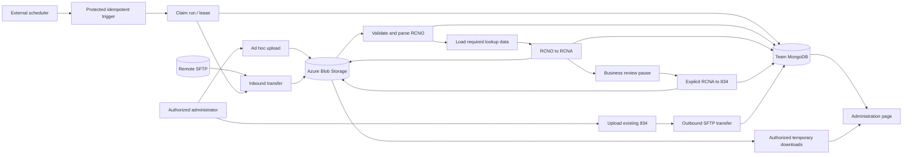

# Directions
- We'll want to create an adminstration page for the RCNO to RCNA to 834 transformations
- The business functionality consists of a periodic batch, probably daily, but should be configurable both by frequency and start time
- The administration page should how job run history: date/time, succeess or failure, number of rows processed, if row failed detailed excedption logging reason etc.
- The RCNO file will be read from a remote nextwork location via SFTP with credentials, assume the credentials will be populated via starting process (KPConfig) - assume properties of RCNOA_USERNAME, RCNOA_PASSWORD as the credentials for both reading from and writing to the remote folder which will be defined by RCNOA_REMOTE_SERVER and RCNOA_REMOTE_FOLDER
- SFTP files pulled from remote server will be stored via azure storage acct and with the use of app\services\blobStorageService.js. Same for created files RCNA and 834 should also be staged in azure storage acct blob storage using app\services\blobStorageService.js before the SFTP'd to the remote server and folder.
-  All azure storage acct blob storage should be associated to the job run id when part of a scheduled run
- The administration page should also enable an upload processing alternative that let's users upload RCNO files and download RCNA and 834 files. -- these files shall be stored on azure blob storage using the existing app\services\blobStorageService.js and be downloadable via temp download links.  All azure storage acct blob storage should be associated to the user nuid in this ad hoc processing model.
- All metadata for this RCNOA processing should be kept cleanly in mongo db - follow repo practices for mongodb storage in a team-name (mongo db database) and assistant-name page route and api (dynamic route) - You can assume a team name of 'reconciliation-notice-processing' and an assistant of 'rcno-rcna-834'
- Follow all repo standards for UI source code practices like the separation of page from client service from api route from server service and using db folder of source: connection.js, insertDocument.js, etc. also note how relationships are established in the mongo db docs and that this repo uses a unique 'id' property, a uuid for assigning uniqueness to mongo db docs

## Actions
- Read the above and rewrite in clear technical writing the intent of this rcnoa admin page
- Review existing code
- Ask me any qustion you may have
- Create a full impl plan with slices of development
- I'll review and approve and you can start.

---

## Rewritten technical intent

### Objective

Create a protected administration experience for operating and monitoring the RCNO-to-RCNA-to-834 reconciliation workflow for:

- team: `reconciliation-notice-processing`
- assistant: `rcno-rcna-834`

The experience must support two processing modes that use the same transformation pipeline:

1. **Scheduled processing** retrieves RCNO input from SFTP, stages it in Azure Blob Storage, transforms it into RCNA, archives the inbound RCNO, and pauses for business review.
2. **Ad hoc processing** allows an authorized user to upload an RCNO file, runs the same RCNA transformation, and pauses for business review.
3. **834 processing** allows an authorized user to generate 834 from a reviewed generated RCNA, upload another RCNA for 834 conversion, or upload an existing 834 for outbound SFTP delivery.

MongoDB stores operational metadata, schedules, run state, row-level failures, audit fields, Blob artifact references, and the minimum normalized prior-RCNA fields required by later reconciliation cycles. MongoDB does not store file payloads, SFTP passwords, storage credentials, raw SSNs, or complete RCNO/RCNA rows.

### Administration-page capabilities

The administration page will provide three work areas without using nested cards:

#### Operations overview

- current schedule status and next planned execution;
- latest run status and progress;
- counts for received, processed, succeeded, blocked, and failed rows;
- input/output artifact availability; and
- a manual refresh action.

#### Schedule configuration

- enable or disable scheduled processing;
- configure frequency, start time, and time zone;
- display last-triggered and next-scheduled timestamps;
- validate configuration before activation; and
- retain who changed the schedule and when.

SFTP credentials are never entered or displayed in the UI. The worker obtains `RCNOA_USERNAME` and `RCNOA_PASSWORD` from process configuration populated by KPConfig. The remote endpoint is supplied through `RCNOA_REMOTE_SERVER` and `RCNOA_REMOTE_FOLDER`.

#### Ad hoc processing

- select and upload one RCNO file;
- validate file type and size before upload;
- stage the file directly in Azure Blob Storage using a short-lived write SAS when appropriate;
- start a run only after upload completion is confirmed server-side;
- display live run status and row counts; and
- issue short-lived read SAS links for completed RCNA and error-report artifacts after server-side authorization;
- upload a separate RCNA file and generate a downloadable 834 artifact; and
- upload an existing X12 834 file for delivery to the outbound SFTP folder.

#### Run history and diagnostics

- server-side pagination and status/date/mode filtering;
- run ID, scheduled/ad hoc mode, requester, start/end timestamps, duration, status, and counts;
- expandable run details showing processing stage, sanitized job error, artifact actions, and row-level failures;
- paginated row-failure details with source row/work-item ID, rule ID, error code, field, sanitized reason, retryability, and timestamp; and
- downloadable error report for high-volume failures.

### Operational workflow



## Existing-code review

### Patterns to reuse

| Concern | Existing implementation to follow |
|---|---|
| Team admin shell | `app/[teamName]/admin/layout.js` and `app/components/admin/AdminLayout.js` |
| Team authorization | `withTeamPermissionGuard` in `app/api/guards.js`; do not use deprecated `withTeamAdminGuard` |
| Permission registry | `app/config/permissions.js` |
| Client/API/service layering | Geisinger preparation client, protected routes, and `app/services/geisingerPreparationService.js` |
| Persistent jobs | `app/services/backgroundJobService.js` and team database naming `team-${teamName}-db` |
| Run-history UI | KPIF/Medicare batch-history tables and polling patterns |
| Blob upload SAS | EDI Workbench `get-upload-url` route and `generateTemporaryUploadLink` |
| Blob download SAS | `generateTemporaryDownloadLink` with server-side metadata/ownership lookup |
| Blob content access | `downloadBlobText` and `downloadBlobReadableStream` |
| Mongo CRUD | `db/connection.js`, `insertDocument.js`, `selectDocument.js`, `updateDocument.js`, and `deleteDocument.js` |
| Document identity | `prepDocument()` UUID `id` and `parentId` relationships |
| RCNO-to-RCNA transform | `app/services/rcnoa/RcnoToRcnaService.js` |
| RCNA-to-834 transform | `app/services/rcnoa/RcnaTo834Service.js` |

### Gaps that require new implementation

- No SFTP client or SFTP abstraction is present in the repository.
- No durable scheduler or distributed schedule-claim mechanism is present.
- No RCNO positional-file parser or RCNA serializer is committed.
- The transformation requires EPDS recent/prior-834 data, MDW membership data, and Mongo prior-RCNA history; adapters and canonical field contracts do not yet exist.
- `RcnaTo834Service` requires approved envelope values and code/relationship mappings.
- Current batch transforms can fail the entire invocation on one invalid row; row-isolated processing and failure persistence must be designed explicitly.
- Generic background-job routes are not sufficient for this feature because RCNOA APIs require dedicated authorization and ownership checks.
- Process-local job maps and fire-and-forget work in a Next.js request are not durable across pod restarts or multiple AKS replicas.

## Proposed architecture

### Route and authorization boundary

Preferred UI route, subject to approval:

```text
/{teamName}/admin/rcnoa
```

The fixed assistant name remains part of API and document scope:

```text
/api/{teamName}/{assistantName}/rcnoa/...
```

Every UI page load and API route must verify a new permission:

```text
admin.rcnoa.processing.manage
```

The server must reject any API request where `teamName` or `assistantName` is not the approved RCNOA pair. NUID, team access, and artifact ownership are derived from the authenticated server session, never trusted from request bodies.

### Runtime components

| Component | Responsibility |
|---|---|
| `RcnoaAdminPage` | Server-side authorization and page composition |
| `RcnoaAdminExperience` | Client state, tabs/sections, polling, forms, tables, and notifications |
| `rcnoaClientService` | Typed fetch wrappers for schedule, runs, failures, artifacts, and ad hoc actions |
| RCNOA API routes | Validate requests, enforce permission, call server services, return `NextResponse` JSON |
| `rcnoaRepositoryService` | Mongo schedule/run/item/artifact CRUD and atomic state transitions |
| `rcnoaBlobService` | Blob naming, upload confirmation, checksums, content access, and temporary links |
| `rcnoaSftpService` | SFTP connection, host verification, inbound download, outbound temp upload plus atomic rename |
| `rcnoaFileService` | RCNO parsing, field-count validation, RCNA serialization, and error-report generation |
| `rcnoaProcessingService` | Durable workflow orchestration and stage transitions |
| Existing transformers | Deterministic RCNO-to-RCNA and RCNA-to-834 business transformations |
| External scheduler/worker | Trigger due work and continue processing independently of browser/API request lifetime |

### MongoDB storage model

Database:

```text
team-reconciliation-notice-processing-db
```

Collection: the repository-standard `user_collection`.

#### Schedule document

```javascript
{
	type: 'RcnoaSchedule',
	id,
	teamName: 'reconciliation-notice-processing',
	assistantName: 'rcno-rcna-834',
	enabled,
	frequency: { unit, interval, daysOfWeek },
	startTime,
	timeZone,
	lastTriggeredAt,
	nextScheduledAt,
	version,
	createdAt,
	createdBy,
	updatedAt,
	updatedBy,
}
```

Only one active schedule is permitted for this team/assistant pair. SFTP credentials are not persisted.

#### Run document

```javascript
{
	type: 'RcnoaRun',
	id,
	parentId: scheduleId || null,
	teamName,
	assistantName,
	mode: 'scheduled' | 'adhoc',
	idempotencyKey,
	requestedBy,
	status: 'QUEUED' | 'PROCESSING' | 'COMPLETE' | 'PARTIAL' | 'ERROR' | 'CANCELED',
	currentStage,
	inputFileName,
	startedAt,
	finishedAt,
	heartbeatAt,
	counts: {
		received,
		processed,
		succeeded,
		blocked,
		failed,
		rcnaWritten,
		members834Written,
	},
	errorCode,
	errorSummary,
	scheduleVersion,
	ruleCatalogVersion,
	configurationVersion,
	createdAt,
	updatedAt,
}
```

#### Run-item document

Store failures/blocked rows separately so large runs do not exceed Mongo document limits:

```javascript
{
	type: 'RcnoaRunItem',
	id,
	parentId: runId,
	sourceRowNumber,
	sourceWorkItemId,
	status: 'BLOCKED' | 'ERROR',
	ruleId,
	errorCode,
	field,
	message,
	retryable,
	attempts,
	createdAt,
	updatedAt,
}
```

Do not store raw row content or PII in this document.

#### Artifact document

```javascript
{
	type: 'RcnoaArtifact',
	id,
	parentId: runId,
	ownerNuid: mode === 'adhoc' ? authenticatedNuid : null,
	direction: 'input' | 'output',
	artifactType: 'rcno' | 'working-rcna' | 'outbound-rcna' | '834' | 'error-report',
	containerName,
	blobName,
	fileName,
	contentType,
	sizeBytes,
	sha256,
	createdAt,
}
```

#### Prior-RCNA record document

Persist the minimum normalized result needed by Rule B after a run completes successfully or partially:

```javascript
{
	type: 'RcnoaPriorRcnaRecord',
	id,
	parentId: sourceRunId,
	reconciliationCycle,
	memberMatchKey,
	sourceWorkItemId,
	noticeCode,
	noticeDescription,
	priority,
	ageDays,
	disposition,
	effectiveAt,
	expiresAt,
	createdAt,
}
```

The canonical match key must be derived according to the approved business contract and protected as sensitive data. Prefer a deterministic keyed hash when Rule B requires equality lookup but does not require recovery of the original identifier. Do not persist full source rows, names, addresses, dates of birth, or raw SSNs in prior-RCNA documents.

Recommended indexes:

- `{ type: 1, id: 1 }` unique;
- `{ type: 1, parentId: 1, createdAt: -1 }`;
- `{ type: 1, teamName: 1, assistantName: 1, createdAt: -1 }`;
- `{ type: 1, idempotencyKey: 1 }` unique and partial for run documents; and
- `{ type: 1, enabled: 1, nextScheduledAt: 1 }` for schedule claims; and
- `{ type: 1, reconciliationCycle: 1, memberMatchKey: 1, effectiveAt: -1 }` for prior-RCNA lookup.

### Blob organization

Use a dedicated team-scoped container and deterministic paths:

```text
rcnoa-processing/scheduled/{runId}/input/{fileName}
rcnoa-processing/scheduled/{runId}/output/{fileName}
rcnoa-processing/adhoc/{nuid}/{runId}/input/{fileName}
rcnoa-processing/adhoc/{nuid}/{runId}/output/{fileName}
```

The scheduled association is the run ID in both the Blob path and artifact `parentId`. The ad hoc association includes authenticated NUID and run ID in the Blob path, plus `ownerNuid` in artifact metadata.

Security requirements:

- issue least-privilege, short-lived SAS URLs only after authorization;
- never persist SAS URLs because they expire;
- sanitize file/path segments and reject path traversal;
- validate blob existence, size, and checksum before creating a run;
- use streaming for large downloads and processing;
- never expose the storage account key to the browser; and
- retain the current server-side Blob helper initially, while treating managed identity and Storage Blob Data Contributor/Reader roles as the target authentication model.

### SFTP processing

Add a server-only SFTP adapter using a maintained Node SFTP library. Required controls:

- credentials read only from KPConfig-populated environment properties;
- configurable port if required;
- strict host-key/fingerprint verification;
- connection and operation timeouts;
- bounded retries with exponential backoff for transient failures;
- deterministic inbound file selection and duplicate detection;
- download to Blob before transformation;
- outbound upload under a temporary remote name followed by atomic rename;
- no passwords, raw file content, or PII in logs; and
- sanitized transfer diagnostics attached to the run.

Successfully processed inbound files must follow an approved remote disposition policy: archive, rename, delete, or leave in place with a durable processed-file ledger.

### Scheduling and durability

Do not use `setInterval`, `node-cron`, or a timer in `server.js`. That approach can duplicate executions across AKS replicas and loses state during restarts.

Use the approved enterprise scheduler. The scheduler should invoke a protected due-run trigger at a fixed heartbeat interval; the application evaluates the persisted frequency/start-time configuration and atomically claims only schedules that are due. This keeps schedule configuration in MongoDB and avoids requiring the administration page to reconfigure the external scheduler.

The trigger creates or claims a run using a deterministic idempotency key, such as schedule ID plus scheduled fire time. The processor updates `heartbeatAt`; stale claims can be recovered according to an approved timeout. The API returns the accepted run immediately and does not keep an HTTP request open for batch completion.

The enterprise scheduler authenticates with the platform-standard workload token. End-user session cookies must not be used for scheduler authentication.

The first release supports daily and selected-weekday schedules in the `America/New_York` time zone. When a scheduled run is already active, a new due execution is recorded as skipped rather than overlapped. Schedule calculations and tests must handle Eastern daylight-saving transitions explicitly.

### Oracle lookup connections

EPDS supplies recent/prior 834 evidence and MDW supplies membership data through two Oracle database connections. KPConfig populates these server-only properties:

```text
RCNOA_EPDS_JDBC_URL
RCNOA_EPDS_USERNAME
RCNOA_EPDS_PASSWORD

RCNOA_MDW_JDBC_URL
RCNOA_MDW_USERNAME
RCNOA_MDW_PASSWORD
```

The EPDS and MDW SQL statements are stored in the versioned MongoDB `RcnoaQueryConfiguration` document. They are seeded from the approved design and edited through the permission-protected RCNOA admin page so changes do not require a build or deployment.

Implementation requirements:

- use the repository's Oracle connection practices and connection pooling;
- treat the configured JDBC URL as the connection descriptor source and adapt it to the Node Oracle driver configuration at the server boundary;
- load the current SQL from MongoDB when each run begins its Oracle lookup;
- allow updates only through the `admin.rcnoa.processing.manage` permission guard, validate a single read-only statement, and use optimistic version checks;
- use bind variables for RCNO keys, business date, and lookup windows;
- validate that configured queries return the canonical EPDS and MDW field aliases expected by the transformation adapter;
- apply query timeouts, bounded retries only for transient connection failures, and deterministic snapshot/business-date semantics;
- never log connection strings, usernames, passwords, SQL bind values containing PII, or returned records; and
- record only sanitized query duration, row counts, source system, and run ID.

Prior RCNA disposition data is not supplied by EPDS or MDW. After each successful or partial run, the processor upserts the minimum normalized prior-RCNA fields into MongoDB. Later runs query those records by reconciliation cycle and protected member match key and map them into `priorRcnaRecords` for Rule B.

### Processing state machine

```text
QUEUED
	-> CLAIMED
	-> RECEIVING_INPUT
	-> INPUT_STAGED
	-> VALIDATING
	-> LOADING_LOOKUPS
	-> GENERATING_RCNA
	-> GENERATING_834
	-> STAGING_OUTPUTS
	-> DELIVERING_OUTPUTS     (scheduled only)
	-> COMPLETE | PARTIAL | ERROR
```

Each transition must be persisted atomically and be idempotent. A retry resumes from persisted artifacts/stage where safe rather than blindly creating duplicate files.

### API surface

All routes are protected with `withTeamPermissionGuard(PERMISSIONS.RCNOA_PROCESSING_MANAGE)` and validate the approved assistant name.

| Method and route | Purpose |
|---|---|
| `GET /api/{teamName}/{assistantName}/rcnoa/schedule` | Read schedule |
| `PUT /api/{teamName}/{assistantName}/rcnoa/schedule` | Validate and update schedule |
| `POST /api/{teamName}/{assistantName}/rcnoa/runs/upload-url` | Create ad hoc run reservation and write SAS |
| `POST /api/{teamName}/{assistantName}/rcnoa/runs/{runId}/start` | Confirm staged input and enqueue processing |
| `POST /api/{teamName}/{assistantName}/rcnoa/runs/trigger` | Protected scheduled trigger with idempotency key |
| `GET /api/{teamName}/{assistantName}/rcnoa/runs` | Paginated/filterable run history |
| `GET /api/{teamName}/{assistantName}/rcnoa/runs/{runId}` | Run status, counts, stage, and artifact metadata |
| `GET /api/{teamName}/{assistantName}/rcnoa/runs/{runId}/items` | Paginated row failures |
| `GET /api/{teamName}/{assistantName}/rcnoa/artifacts/{artifactId}/download` | Authorized temporary read link |
| `POST /api/{teamName}/{assistantName}/rcnoa/runs/{runId}/retry` | Retry an eligible failed run, if approved |

The scheduled trigger should use workload authentication or a shared platform mechanism, not an end-user browser session. Its exact authentication model is an approval question.

### Logging and audit

Use the repository `kpmsg` structure with ID `AI_PORTAL_NOTEBOOK`. Log:

- run ID, stage, status, counts, elapsed time, artifact IDs, and sanitized error codes;
- schedule changes and trigger claims;
- SFTP operation type and remote file name only when the name contains no PII; and
- Blob container/path identifiers only when policy permits.

Never log credentials, SAS tokens, raw RCNO/RCNA/834 content, names, dates of birth, addresses, member IDs, or complete SSNs.

## Development slices

### Slice 0: Resolve production contracts

- Use the approved team-admin route and single RCNOA permission.
- Use workload-token authentication for the enterprise scheduler and support daily/selected-weekday Eastern schedules without overlap.
- Implement the approved EPDS and MDW Oracle connection contracts and Mongo-backed prior-RCNA history.
- Finalize the SFTP interface contract; keep transport activation blocked while provisional defaults are in use.
- Resolve production-blocking RCNA/834 mappings identified in the detailed design.
- Enforce the approved RCNO/RCNA framing and OPM transfer names, including the optional `TST_` prefix and `.txt.pgp` compound extension; finalize separate 834 and error-report naming.
- Decide row-failure continuation and partial-output policy.

Validation: approved configuration contract and acceptance examples exist before transport or UI is activated.

### Slice 1: File contracts and transformation adapter

- Implement streaming RCNO parser and RCNA serializers.
- Add file-level and row-level validation contracts.
- Adapt committed transformation services to row-isolated processing where required.
- Generate a sanitized error report.
- Connect the comprehensive rule catalog to the committed services rather than relying only on the reference harness.

Validation: parser/serializer round trips, width checks, malformed-row handling, all rule tests, and X12 validation pass without network or database dependencies.

### Slice 2: Mongo repository and state machine

- Implement schedule, run, run-item, artifact, and prior-RCNA repositories using existing DB helpers.
- Add explicit indexes and idempotent state transitions.
- Add heartbeat, stale-run recovery metadata, pagination, and retention fields.

Validation: concurrent claim tests, duplicate trigger tests, transition guards, pagination, and document-size tests.

### Slice 3: Blob staging and authorized artifact access

- Implement deterministic Blob paths and artifact metadata.
- Add direct ad hoc upload SAS flow with server-side upload confirmation.
- Add short-lived download links with team permission and NUID ownership checks.
- Add checksums, size limits, content-type validation, and cleanup hooks.

Validation: unauthorized access, cross-user access, expired links, missing blobs, large-file streaming, and path-sanitization tests.

### Slice 4: Protected APIs and client service

- Add the dynamic team/assistant RCNOA routes.
- Add a dedicated client service with consistent JSON/error handling.
- Protect every endpoint with the new team permission and route-scope validation.

Validation: 400/403/404/409/500 contracts, assistant mismatch, ownership checks, and no sensitive response fields.

### Slice 5: Ad hoc workflow

- Implement upload, run creation, lookup loading, transformation, output staging, polling, and downloads.
- Persist per-row failures separately and create an error-report artifact.
- Continue valid rows when individual rows fail and mark the run `PARTIAL` when at least one valid output and one row failure exist.
- Keep processing independent of browser lifetime.

Validation: successful run, partial run, malformed file, lookup failure, transform failure, restart/recovery, and duplicate-start tests.

### Slice 6: Administration UI

- Add the protected MUI administration page and team navigation entry.
- Build schedule controls, upload workflow, active-run progress, paginated history, expandable diagnostics, and artifact actions.
- Use existing button variants (`primary`, `secondary`, `action`, `destructive`, `positive`, `text`) and MUI icons/tooltips.
- Provide accessible loading, empty, success, partial, error, and forbidden states.

Validation: component behavior, keyboard access, responsive layout, long error text, polling cleanup, and existing admin-navigation regression.

### Slice 7: SFTP transport

- Add the SFTP adapter, configuration validation, host-key verification, retries, duplicate detection, and remote atomic rename.
- Stage inbound files in Blob before parsing.
- Deliver only approved completed artifacts and persist transfer outcomes.

Validation: mocked SFTP success, timeout, authentication failure, host-key mismatch, duplicate input, partial transfer, retry, and atomic rename tests.

### Slice 8: Durable scheduling

- Integrate the approved enterprise scheduler through a workload-authenticated due-run trigger.
- Implement schedule calculation, atomic claims, idempotency, heartbeat, and stale-run recovery.
- Prevent overlapping runs according to approved policy.

Validation: daylight-saving boundaries, missed runs, concurrent triggers, multi-replica claims, worker restart, disabled schedules, and overlap behavior.

### Slice 9: End-to-end readiness

- Add observability, retention/cleanup, operational runbook, and reconciliation reports.
- Apply approved defaults: retain Blob artifacts for 90 days, retain run/error audit metadata for seven years, limit ad hoc uploads to 100 MB, and issue 15-minute upload/download SAS links.
- Exercise scheduled SFTP and ad hoc paths in a non-production environment.
- Verify Blob, Mongo, SFTP, and transformation audit linkage by run ID.
- Complete security review and production configuration validation.

Validation: end-to-end test evidence, rollback procedure, no-PII logging review, access review, recovery drill, and release checklist.

## Acceptance criteria

1. Only authorized team users can view or operate RCNOA administration features.
2. Every scheduled or ad hoc invocation has one UUID run ID and a complete persisted state history.
3. Every input/output artifact is staged in Blob Storage and linked to its run; ad hoc artifacts are additionally linked to authenticated NUID.
4. Scheduled input and output transfers are idempotent and recoverable without duplicate remote delivery.
5. The UI shows accurate status, timestamps, counts, artifacts, and sanitized row errors with server-side pagination.
6. A row failure follows the approved continuation policy and cannot silently corrupt another row or output file.
7. Download links are short-lived and issued only after server-side permission and ownership checks.
8. No secrets, SAS tokens, or PII appear in logs or Mongo operational metadata.
9. Multiple application replicas or duplicate scheduler calls cannot claim the same scheduled execution twice.
10. Production processing remains disabled until all required lookup sources and 834 configuration values are approved.

## Approved design decisions

1. Use `/{teamName}/admin/rcnoa` and one permission, `admin.rcnoa.processing.manage`, for schedule management and ad hoc operations.
2. Use the enterprise scheduler as the durable trigger source. The application retains schedule configuration and atomically determines whether a run is due.
3. Authenticate the scheduler with a platform workload token. Support daily and selected-weekday schedules in `America/New_York`, and skip overlapping scheduled runs.
4. Load recent/prior 834 evidence from EPDS Oracle and membership information from MDW Oracle using KPConfig-populated connection/query properties.
5. Persist the minimum normalized prior-RCNA history required by Rule B in MongoDB and protect equality match keys with a keyed hash when recovery is unnecessary.
6. Use the approved RCNO/RCNA framing: UTF-8, pipe-delimited data rows with no header or trailer. Use the OPM RCNO/RCNA transfer naming contract, continue to use one input file per run and SFTP port 22, and archive inbound files after successful processing.
7. Continue processing valid rows when individual rows fail. Produce partial outputs plus an error report and mark the run `PARTIAL`.
8. Retrying a failed or partial run creates a child run that reuses the immutable staged input; the original run remains unchanged for audit.
9. Retain Blob artifacts for 90 days and run/error audit metadata for seven years. Limit uploads to 100 MB and SAS links to 15 minutes.

## Remaining questions requiring approval

1. Provide the archive folder/name, 834/error-report output naming conventions, approved PGP key-handling process, and approved known-hosts mechanism. RCNO/RCNA names, delimiter, and row framing are fixed by the approved interface specification.
2. Identify the roles/users that initially receive `admin.rcnoa.processing.manage`.
3. Provide or reference the platform-standard workload-token validation contract used by the enterprise scheduler.
4. Confirm the canonical prior-RCNA member match key and reconciliation-cycle definition used by Rule B.
5. Confirm whether the N12 code, I-family discriminator, RCNA-code-to-834 intent map, envelope constants, relationship map, and address-line handling are approved elsewhere. Production processing remains blocked until these values are supplied.